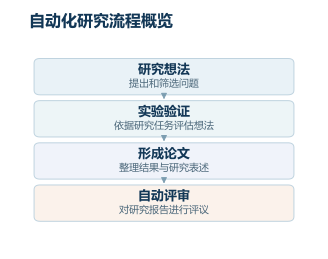

> 论文：[Towards end-to-end automation of AI research](https://www.nature.com/articles/s41586-026-10265-5)。


# The AI Scientist｜将科研流程连接为自动化研究闭环

# 00. 引言：这篇论文想解决什么

这篇 Nature 论文讨论的是一个更大的问题：人工智能能否不只是辅助科研，而是自动完成一轮完整科研流程。过去的科研自动化大多停留在局部环节，例如生成假设、写代码、做文献综述、分析数据、设计实验或生成论文草稿；但这些模块之间通常需要人类研究者串联。本文提出的 The AI Scientist 试图把“选题—查新—实验—作图—写论文—审稿”连接成一个端到端系统。论文最核心的结果是：该系统生成的 3 篇论文被提交到一个 ICLR 2025 workshop，其中 1 篇达到 workshop 接收标准，但按预设协议在评审后撤回。

全文主线很清晰：作者不是证明 AI 已经能稳定产出顶会级原创研究，而是证明“完整科研生命周期自动化”已经可以在机器学习这种纯计算实验领域形成闭环，并且质量会随基础模型能力与测试时计算量提升而改善。

# 01. 背景问题：为什么这件事难

## 1. 科研不是一个单任务，而是长链条决策系统

机器学习研究至少包含 6 类能力：

1. 发现值得研究的问题；
2. 判断已有文献是否已经做过；
3. 把想法落成可运行代码；
4. 处理报错、调参、补实验；
5. 分析结果并形成图表；
6. 写成符合学术规范的论文并接受评审。

过去的大语言模型（large language model，大语言模型）在其中某些环节已经很强，例如代码生成、摘要写作、实验规划。但端到端科研困难在于：每一步的错误都会向后传播。一个想法不新，后面实验再完整也没有意义；代码实现错了，论文写得再像也只是包装错误结果；引用错了，论文可信度会崩。

## 【背景知识：科研自动化里的“端到端”到底指什么】

这里的端到端不是深度学习里常说的“输入原始数据、输出预测结果”的端到端，而是“科研流程级端到端”。输入可以只是一个研究主题或代码模板，输出是一篇完整论文。中间包括自主搜索、执行、调试、分析、写作和评审。

这和普通智能体（agent，智能体）最大的区别是：科研任务没有固定答案，也没有单一奖励函数。它既要探索新问题，又要保证实现正确；既要生成新东西，又要避免重复已有工作；既要写得像论文，又不能靠幻觉堆砌。

# 02. 方法核心：作者到底做了什么

## 2.1 整体流程：四阶段科研流水线

The AI Scientist 的主流程分成四个阶段：想法生成、实验执行、论文写作、自动评审。图 1a 展示了这一闭环：语言模型生成研究想法，通过文献查新筛掉重复方向；随后进入实验阶段，完成初步验证、超参数调整、主实验和消融实验；实验结果被转成图表并写入论文模板；最后由自动审稿器打分。

*依据本节内容绘制的概念示意；自动评审仍需结合人工判断。*

这个设计的关键不在于某一个模块特别新，而在于把科研中最容易断裂的环节做成了可递归调用的工程系统。

## 2.2 模板模式：在人类给定代码骨架上做研究

模板模式（template-based）需要人类提供一个初始代码模板，例如一个可复现的训练脚本。系统在这个代码基础上提出改进想法、修改代码、运行实验、记录日志、生成论文。

输入：研究子领域 + 初始代码模板。  
输出：基于该模板扩展出来的完整实验和论文。  
解决的问题：降低开放式科研的搜索空间，让系统更容易完成闭环。  
主要局限：创新空间被初始模板强约束，更像“自动扩展现有项目”，不是真正开放探索。

论文中提到，模板模式会让系统维护一个想法档案，每个想法包含标题、核心假设、实验计划，以及对有趣性、新颖性、可行性的自评分；再通过 Semantic Scholar 接口进行最多 10 轮文献查新。

## 2.3 无模板模式：用树搜索做开放式实验探索

无模板模式（template-free）是本文更值得关注的部分。它不依赖人类给定的起始代码，而是从高层研究提案开始，自主生成代码、执行实验、修复错误、扩展实验节点。

输入：较宽泛的研究主题，例如 workshop 主题。  
输出：从零生成的实验代码、图表和论文。  
解决的问题：突破固定代码模板带来的探索限制。  
关键直觉：科研不是线性流程，而是一个分支搜索过程。某个实验失败后，可以调试；某个实验成功后，可以扩展、复现、消融。

图 3a 和图 3b 很关键：作者把实验过程组织成树搜索。节点可以是正常实验、报错实验、超参数实验、消融实验、复现实验或聚合实验。每个阶段选出最优节点作为下一阶段的起点。

## 2.4 自动审稿器：把论文质量评估也纳入闭环

The Automated Reviewer 使用 5 个独立评审结果再进行元评审，输出 soundness、presentation、contribution、overall score 和 accept/reject 决策。作者用 ICLR 公开评审数据验证其与人类评审决策的一致性，并与 NeurIPS 2021 human consistency experiment 做对比。

这个模块的作用不是替代人类审稿，而是让作者可以大规模比较不同系统配置：模型越新，论文得分是否更高；测试时计算量越大，论文质量是否提升。

# 03. 关键机制拆解：最值得理解的技术点

## 3.1 “科研树搜索”比线性智能体更接近真实研究

传统智能体常见流程是：计划 → 执行 → 反思 → 修复。这种线性结构适合做软件任务，但不适合科研。科研中经常出现多个候选路线，需要并行试错和保留分支。

The AI Scientist 的无模板版本把实验拆成 4 个阶段：

1. 初步验证：先确认想法能否跑通；
2. 超参数调整：稳定训练曲线和结果；
3. 主实验执行：围绕核心研究假设展开；
4. 消融实验：验证哪些组件真正有用。

每个节点都包含实验脚本、实验计划、运行日志、指标、图表、视觉语言模型反馈、错误状态等。成功节点会被扩展，失败节点会进入调试分支。这个设计本质上把“科研经验”转成了一个可执行的搜索策略。

## 3.2 自动作图与视觉语言模型反馈，是减少伪结果的重要工程补丁

论文里一个容易被忽略的点是视觉语言模型（vision-language model，视觉语言模型）的使用。系统不仅生成实验结果，还会生成图表；随后视觉语言模型检查图表是否有轴标签错误、图例缺失、可视化误导、图文不一致等问题。

这很重要，因为很多“自动科研”失败不在想法，而在结果呈现：

- 曲线图横纵轴错了；
- caption 说的是一个结论，图里并不支持；
- 多个图重复；
- 消融实验没有真正隔离变量；
- 统计结果缺少均值和标准差。

作者通过复现实验节点和聚合节点让系统计算均值、标准差并生成汇总图，这比简单跑一次实验更接近真实机器学习论文规范。

## 3.3 自动审稿器不是“真理机器”，而是系统优化用的代理指标

自动审稿器的核心价值是可扩展评估。论文报告其在 2017–2024 年 ICLR 论文上 balanced accuracy 为 0.69，在 2025 年 cutoff 后数据上为 0.66；作为对比，NeurIPS 2021 人类评审一致性实验中的 human balanced accuracy 约为 0.66。

但这里需要保留判断：自动审稿器只能近似“平均审稿人偏好”，不能证明论文真正正确。它可能偏好格式完整、叙事流畅、实验看似规范的论文；而真正的科学贡献往往需要更长周期的社区检验。

# 04. 实验验证：结果到底说明了什么

## 4.1 自动审稿器验证：它能否近似人类审稿判断

任务：预测会议论文接收或拒稿。  
指标：balanced accuracy、accuracy、F1、AUC、FPR、FNR。  
结论：自动审稿器在公开 ICLR 数据上接近人类评审一致性水平。

这里的 balanced accuracy 很关键，因为会议论文通常接收和拒稿类别不均衡。普通 accuracy 可能被“总是拒稿”策略虚高；balanced accuracy 会同时考虑接收类和拒稿类的判断能力。表 1 显示，“always reject”的 accuracy 可以不低，但 F1 为 0，说明它完全不能识别应接收论文。自动审稿器在 F1 和 balanced accuracy 上更有意义。

## 4.2 模型规模验证：基础模型越强，论文质量越高

图 1b 显示，随着底层模型发布时间推进，The AI Scientist 生成论文的自动审稿得分整体上升，拟合相关显著。作者据此认为，系统能力会随基础模型进步而自然增强。

这个结果说明两件事：

- 该系统不是只靠固定流程，底层模型能力会直接影响科研质量；
- 未来提升不一定来自重新设计整个系统，也可能来自更强的推理、代码和多模态模型。

但这不是严格证明“未来一定会达到顶会水平”。它只是显示了一个经验趋势。

## 4.3 测试时计算量验证：更多实验节点带来更高论文得分

图 3c 显示，无模板模式下，实验树搜索节点数从较小预算增加到约 32 个节点时，自动审稿得分上升。

技术含义：科研智能体的质量不仅由模型参数决定，也由测试时计算量决定。更多节点意味着更多调试、更多尝试、更多消融和更好的实验筛选。这和当前推理模型中的“test-time compute scaling”方向一致。

需要注意：这类扩展会带来成本问题。如果用于真实科研，计算预算、数据访问、实验安全、结果复核都将成为系统边界。

## 4.4 人类评审验证：1 篇 AI 论文达到 workshop 接收标准

最强证据来自真实 workshop 投稿实验。作者生成 3 篇论文，并在 ICLR 2025 ICBINB workshop 组织方和伦理审批同意下提交。评审知道有少量 AI 生成论文，但不知道哪几篇。结果其中 1 篇平均分 6.33，三个评分为 6、7、6，超过该 workshop 平均接收阈值；但按预设协议，所有 AI 生成论文在评审后撤回。

这个结果证明：AI 生成论文已经可以在较低门槛的同行评审环境中“看起来像有效研究”，并达到接收线。

它没有证明：

- AI 已经能稳定产出高水平原创研究；
- AI 论文能达到 ICLR main conference 标准；
- 实验结论一定可靠；
- 系统不需要人类筛选。

作者也明确写到，团队内部研究者认为没有一篇达到 ICLR 主会水平。

# 05. 这项工作的真正价值

这篇论文的价值不是某个算法模块特别突破，而是工程范式上的变化：把科研过程从“人类主导、AI 辅助”推向“AI 主导、人类监管”。

它可能影响三个方向：

1. **机器学习研究自动化**：自动提出 baseline 改进、做消融、写短论文或 workshop 论文；
2. **科研智能体评估体系**：自动审稿器、实验树搜索、论文生成质量评估会成为独立研究方向；
3. **AI for Science 工作流**：在计算实验可自动运行的领域，例如材料、蛋白、药物设计、自动化化学实验室，这套框架可以迁移。

对药物设计尤其有启发：真正有价值的 Auto Research 系统不应只会调用 docking、生成分子或写报告，而应能维护假设档案、查重、设计实验、调用模型训练和虚拟筛选、失败后修复流程，并生成可被人类审查的实验记录。

# 06. 局限与需要验证的点

1. **质量还不稳定**  
   3 篇投稿只有 1 篇达到 workshop 接收标准，而且 workshop 接收率约 70%，远高于 ICLR 主会约 32%。这说明系统还不是顶会级科研机器。

2. **仍然存在人工筛选**  
   作者在 workshop 投稿前人工筛选了最有希望的输出，筛选标准包括主题契合度、代码实现正确性和论文格式正确性。严格来说，这不是完全无人监管的科研发表流程。

3. **实验域主要限于计算型机器学习研究**  
   当前系统只做计算实验。迁移到湿实验、化学合成、药物发现，需要额外解决实验安全、机器人平台、数据闭环和成本问题。

4. **自动审稿器可能放大学术表象偏好**  
   它能拟合平均审稿判断，但不能保证科学真实性。格式完整、图表漂亮、叙事顺滑的错误研究仍可能被高估。

5. **幻觉和错误实现仍是核心风险**  
   论文明确列出失败模式：想法幼稚、方法不严谨、实现错误、图表重复、引用不准、各种幻觉。

# 07. 总结与延伸探讨

这项工作最值得记住的一点是：它把“AI 能不能做科研”从抽象讨论推进到了可运行系统层面。The AI Scientist 还不是可靠的顶尖科学家，但已经能在机器学习这类计算实验领域完成一轮接近真实论文生产的闭环。

更高层看，它代表的是一种新科研生产方式：人类不再只让 AI 做单个工具函数，而是把研究过程拆成可搜索、可执行、可评估、可迭代的系统。下一步真正关键的方向不是单纯让模型更会写论文，而是让它更可靠地提出有价值问题、验证实现正确性、控制幻觉、保留完整实验溯源，并允许人类在关键节点做审计。

对于 AI 药物设计，最直接的启发是：未来的 Auto Research 不应只是“分子生成 + 打分 + 总结”，而应是“假设管理 + 文献查新 + 模型实验 + 分子实验代理 + 多轮筛选 + 可审计报告”的闭环系统。真正的壁垒会在实验可靠性、任务编排、领域工具集成和结果验证，而不只是底层大模型本身。


