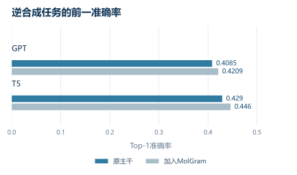

> 论文：[Augmenting Molecular Language Models with Local n-gram Memory](https://arxiv.org/abs/2606.12113)。


# MolGram｜以局部语法记忆增强分子语言模型

# 00. 引言：这篇论文想解决什么

这篇论文讨论的是一个长期存在但经常被低估的问题：基于简化分子线性输入规范（SMILES）的分子语言模型，虽然形式上可以直接套用转换器（Transformer），但字符级分词会把化学上连续、有意义的局部结构拆碎。比如羰基 `C(=O)` 被拆成多个字符，苯环 `c1ccccc1` 也被拆成一串局部字符。模型必须在大量层和注意力头里反复学习这些局部模式，导致本应用来建模长程依赖、反应逻辑和分子整体结构的容量被消耗掉。论文把这个问题称为“局部性缺口”。

MolGram 的核心思路不是换分词器，也不是改 SMILES 表示，而是在模型侧增加一个轻量的 n 元语法记忆模块：把局部连续字符片段通过哈希查表映射为可学习嵌入，再用门控机制判断这些局部模式是否对当前位置有用，最后注入到转换器隐藏状态中。它试图在保留标准字符级 SMILES 的前提下，让模型显式拥有“局部化学模式记忆”。

# 01. 背景问题：为什么这件事难

## 1. SMILES 的局部结构和字符序列并不天然对齐

SMILES 是线性字符串，但分子本质上是图结构。某些化学片段在图上是局部结构，在字符串里可能被拆成多个字符；某些图上相邻的原子，在字符串里也可能被环闭合符号、支链括号、方向键等语法隔开。

【背景知识：字符级分词的局限】

字符级分词的优点是简单、通用、不会引入复杂词表；缺点是它不知道哪些字符组合构成化学片段。例如：

```text
C(=O)O
```

从字符看是 `C`、`(`、`=`、`O`、`)`、`O`；  
从化学看是羧酸相关局部模式。

模型如果只看到字符，就必须自己从训练目标里归纳“哪些相邻字符经常一起出现、代表什么局部结构”。这在数据足够大时可行，但效率低。

## 2. 现有解决路线主要有两个代价

已有方法通常从表示层面解决局部性问题：

| 路线 | 做法 | 问题 |
|---|---|---|
| 子词分词 | 用字节对编码等方法学习常见片段 | 片段不一定化学合理 |
| 片段表示 | 使用 SAFE、fragSMILES 等片段级表示 | 数据处理复杂，和标准 SMILES 生态不完全一致 |
| SMILES 枚举 | 用不同写法增强数据 | 提升鲁棒性，但不能直接减少局部模式学习负担 |

MolGram 的定位是第三种路线：不改变输入表示，而是在模型内部加入可查找的局部模式记忆。它更像是给转换器外挂一个“局部片段缓存”。

# 02. 方法核心：作者到底做了什么

## 2.1 n 元语法哈希映射：把局部字符片段变成可查表记忆

**输入**：当前位置附近的连续 token，例如 2 元、3 元、4 元片段。  
**输出**：对应的 n 元语法嵌入向量。  
**解决的问题**：让模型不必每次都从注意力中重新发现局部模式。  
**关键直觉**：SMILES 中大量化学信息存在于短窗口里，例如芳香环、羰基、硝基、卤素取代、支链开闭等。

论文使用哈希查表，而不是显式保存所有 n 元语法字符串。对位置 `t` 和窗口大小 `n`，先构造混合键：

$$
\mathrm{key}^{(n)}_t=\bigoplus_{j=0}^{n-1} m_j \cdot x_{t-j}
$$

其中，$$x_{t-j}$$ 是 token 编号，$$m_j$$ 是预生成的大奇数乘子，$$\oplus$$ 是按位异或。随后通过取模映射到哈希表索引：

$$
b^{(n)}_t = \mathrm{key}^{(n)}_t \bmod S^{(n)}
$$

这里的 $$S^{(n)}$$ 是对应 n 元语法表的大小，论文选择不小于指定容量的最小素数，以减少碰撞。

这个设计的工程价值很直接：查找复杂度近似为常数，不需要维护庞大的显式 n 元语法词典。

## 2.2 多头哈希：降低碰撞风险

单个哈希表一定存在碰撞，即不同局部片段可能落到同一个位置。MolGram 使用多头设计：每种 n 元语法被映射到多个独立哈希头，每个头有自己的表和取模空间。多个头的嵌入被拼接起来：

$$
e_t = \mathrm{Concat}_{n,m}\left(e^{(n)}_{t,m}\right)
$$

这类似于用多个独立视角描述同一个局部片段。即便一个头发生碰撞，其他头仍可能区分出不同模式。

## 2.3 子结构感知门控：判断记忆是否该注入

哈希表得到的是静态局部模式记忆，但同一个字符片段在不同上下文中的意义不同。因此 MolGram 让主干模型的隐藏状态 $$h_t$$ 作为查询，n 元语法嵌入 $$e_t$$ 投影为键和值：

$$
k_t = W_k e_t + b_k,\quad v_t = W_v e_t + b_v
$$

然后计算相关性：

$$
\alpha_t=
\frac{
\langle \mathrm{RMSNorm}(k_t), \mathrm{RMSNorm}(h_t)\rangle
}{
\sqrt d
}
$$

再经过符号保持的平方根压缩和 Sigmoid 得到门控值：

$$
g_t=\sigma\left(\mathrm{sign}(\alpha_t)\sqrt{|\alpha_t|}\right)
$$

最后得到被调制后的局部记忆贡献：

$$
\tilde v_t = g_t \cdot v_t
$$

这个门控的作用是：当前位置如果需要局部化学模式，就增强记忆；如果当前位置只是括号、孤立字符或语法噪声，就压低记忆。

## 2.4 短卷积：让相邻局部模式组合成更高阶片段

单个 n 元语法只能看到短窗口，但化学子结构通常由多个相邻模式组合而成。MolGram 在门控后加入轻量深度卷积：

$$
z_t = \mathrm{SiLU}\left(\mathrm{DWConv}_c(\tilde v_{t-c+1:t})\right)
$$

最终注入隐藏状态：

$$
\hat h_t = h_t + \tilde v_t + z_t
$$

这里的含义是：  
$$\tilde v_t$$ 提供当前位置的局部记忆，$$z_t$$ 提供邻近局部记忆的组合信息。比如羰基附近接羟基时，可以形成羧酸相关模式。

# 03. 关键机制拆解：最值得理解的技术点

## 3.1 真正的新意不是 n 元语法，而是“模型侧局部记忆”

传统 n 元语法本身不新，哈希查表也不新。MolGram 的贡献在于把它包装成可训练、可门控、可插入转换器层的条件记忆模块，并应用到分子语言模型中。

它和子词分词的差别在于：

| 对比项 | 子词分词 | MolGram |
|---|---|---|
| 是否改变输入序列 | 改变 | 不改变 |
| 是否依赖新词表 | 是 | 不显式依赖 |
| 是否可保留字符级 SMILES | 否或部分否 | 是 |
| 局部模式是否可学习 | 通过 token 嵌入 | 通过哈希记忆表 |
| 是否上下文自适应 | 通常弱 | 有门控 |

因此，MolGram 更像是“字符级模型 + 局部片段外挂记忆”，而不是新的分子表示。

## 3.2 门控机制避免“所有局部片段都强行注入”

如果简单把 n 元语法嵌入加到隐藏状态里，会有两个问题：

1. 哈希碰撞带来的错误记忆可能污染表示；
2. 不重要的字符位置也会被注入局部模式，增加噪声。

门控机制让主干模型决定“当前上下文是否需要这条局部记忆”。这也是论文图 2 的核心证据：门控在芳香环内部、硝基 `[N+]([O-])`、酰胺、卤素、吡啶氮、醚氧等位置更强，而在闭括号、部分环闭合端点、孤立脂肪碳等位置较弱。

这说明模块不是无差别加参数，而是在化学上更有意义的位置提供更大残差贡献。

## 3.3 卷积补上了 n 元语法之间的组合性

哈希查表只能识别离散局部片段，但化学结构的意义经常来自组合。例如：

```text
C(=O)O
```

单独的 `C(`、`=O`、`)O` 都不完整，组合后才更接近羧酸模式。短卷积的作用就是让相邻记忆发生局部混合。

这给模型引入了一个明确归纳偏置：相邻局部片段之间存在可组合关系。它比全局注意力更便宜，也更贴合 SMILES 的短程语法。

# 04. 实验验证：结果到底说明了什么

## 4.1 无条件分子生成：提升存在，但幅度偏小

任务是在无条件下生成有效、新颖、接近训练分布的分子。论文在 MOSES 和 GuacaMol 上评估 MolGPT 与 MolGram-GPT。

关键结果：

| 数据集 | 结论 |
|---|---|
| MOSES | MolGram 在有效率、唯一性、新颖性、FCD 上均略优 |
| GuacaMol | MolGram 在有效率、唯一性、归一化 FCD、KL 上提升 |
| 参数对比 | 约 2700 万参数 MolGram 可超过约 8500 万参数 MolGPT 的多数指标 |

这里最重要的不是绝对数值，而是参数效率。MOSES 和 GuacaMol 的很多指标已经接近饱和，例如有效率和唯一性都很高，所以 MolGram 的增益不会特别大。它更能说明：显式局部记忆在分子语法与分布拟合上有稳定帮助，但不是生成范式级突破。

## 4.2 正向反应预测：更能体现局部模式记忆的价值

正向反应预测要求模型根据反应物和试剂预测产物。相比无条件生成，它更依赖局部官能团、反应中心和上下文关系。

论文在 USPTO-MIT 上测试两种输入：

| 设置 | 含义 |
|---|---|
| 分离设置 | 反应物和试剂用分隔符区分 |
| 混合设置 | 所有物种拼接，不显式标注角色 |

结果显示，MolGram 在 GPT 和 T5 两类主干上都提高前一、前二、前五准确率。尤其在 T5 上，约 1500 万参数的 MolGram-T5 超过约 4410 万参数的 T5Chem。

这说明局部 n 元语法记忆不只是提升 SMILES 合法性，也能帮助反应相关模式识别。合理推断是：官能团、键型、芳香系统、离去基等局部字符串模式被记忆后，模型更容易把容量用于反应映射和产物生成。

## 4.3 单步逆合成：小数据场景下收益更明显

USPTO-50k 规模比 USPTO-MIT 小，逆合成任务又要求从产物推断可能反应物，对局部断键模式和官能团先验更敏感。

论文结果显示：



*按文章现有表格重绘；数据对应文中USPTO-50k任务。*

| 主干 | MolGram 提升 |
|---|---|
| GPT | 前一准确率从 0.4085 提升到 0.4209 |
| T5 | 前一准确率从 0.4290 提升到 0.4460 |
| 参数效率 | 小 MolGram 超过大尺寸无记忆基线 |

这部分最能支持作者主张：当训练数据有限时，显式局部记忆可以作为有效归纳偏置，减少模型从数据中重新学习局部化学规律的负担。

## 4.4 门控可视化：有解释性，但证据仍偏定性

图 2 展示不同 SMILES 位置的 MolGram 残差贡献比例。深色位置集中在芳香环、硝基、酰胺、卤素、杂原子等局部化学结构上。这个结果支持“MolGram 学到了化学相关局部模式”的说法。

但需要保留判断：这只是代表性可视化，不等价于严格证明模块一定理解了化学子结构。更强的证据应包括系统性统计，例如不同官能团类别上的平均门控强度、反应中心附近的激活分布、哈希碰撞率与性能关系等。

# 05. 这项工作的真正价值

1. **它提供了 SMILES 模型的低成本增强路线**  
   不需要放弃字符级 SMILES，也不需要切换到复杂片段表示。

2. **它把“局部化学模式”显式变成模型归纳偏置**  
   对分子生成、反应预测、逆合成都有一致收益。

3. **它强调参数效率，而不是单纯扩大模型**  
   论文最有说服力的结果是小 MolGram 多次超过 3 倍参数量左右的基线模型。

4. **它对分子扩散语言模型也有启发**  
   合理推断：对于基于 SMILES 的离散扩散模型，局部 n 元语法记忆可用于提升低掩码比例下的片段恢复、官能团补全、语法闭合稳定性。但论文没有验证扩散模型，这是外推。

5. **它解决的是“表示效率”和“局部先验注入”，不是完整分子结构理解**  
   MolGram 仍然在字符串表面工作，不能替代图结构、三维构象或反应机理建模。

# 06. 局限与需要验证的点

1. **仍依赖 SMILES 表面字符串**  
   同一个分子在不同 SMILES 写法下可能产生不同 n 元语法，图同构不保证被记忆模块自然捕获。论文也承认需要依赖 SMILES 枚举增强图不变性。

2. **窗口大小有限**  
   n 元语法只能覆盖短程模式，远距离环闭合、大环构象、立体化学长程依赖仍要交给主干注意力。

3. **实验主干较小，缺少大规模预训练验证**  
   模型从随机初始化训练，尚未说明在 ChemBERTa、MoLFormer、ReactionT5 等大规模预训练体系中是否仍有同等收益。

4. **生成任务提升有限**  
   MOSES 和 GuacaMol 的指标接近饱和，MolGram 的绝对提升较小，不能据此说明它显著提升真实药物设计能力。

5. **缺少更细 ablation**  
   论文给出不同 n 元范围、插入层和哈希配置，但正文没有充分展开系统消融。哪些收益来自哈希记忆、哪些来自门控、哪些来自卷积，需要进一步验证。

# 07. 总结与延伸探讨

总体评价：MolGram 是一个工程上很聪明、理论上不复杂、但很贴合 SMILES 痛点的模型侧增强方法。

它最值得记住的点是：不要总是通过更复杂的分子表示或更大的模型去解决 SMILES 的局部性问题；把局部片段模式显式存进可学习记忆，并用上下文门控选择性注入，也可以带来稳定收益。

下一步最值得推进的方向有三个：  
1. 在大规模预训练分子语言模型中验证是否仍有收益；  
2. 将 n 元语法记忆和反应中心、官能团、BRICS 片段等化学规则对齐；  
3. 迁移到离散扩散 SMILES 模型中，测试是否能改善条件补全、片段生成和语法有效率。


