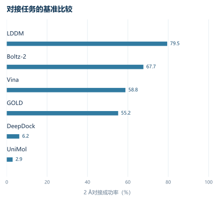


# LDDM｜以片段掩码与反应空间搜索设计可合成分子

# 00. 引言：这篇论文想解决什么

过去几年的结构药物设计（structure-based drug design，SBDD）生成模型，已经逐渐解决了一个早期问题：**能不能直接在蛋白口袋里生成具有合理三维构象的分子**。从 Pocket2Mol、DiffSBDD，到 DrugFlow，再到 2026 年发表的 FLOWR，这条路线已经能够同时生成原子、化学键和三维坐标，并明显改善几何有效性与蛋白—配体相互作用恢复。FLOWR 甚至已经把从头生成、片段条件生成和相互作用条件生成统一到了同一个流匹配框架里。

因此，LDDM（大型药物发现模型，Large Drug Discovery Model）真正瞄准的已经不是“有没有一个更好的三维生成器”，而是更接近实际药物发现的三个后续瓶颈：

1. **同一个模型能否承担不同设计任务**：对接、片段生长、连接体设计、局部修改、从头生成；
2. **生成过程能否受精细局部约束控制**：例如要求某个片段形成氢键、减少未满足氢键、保留已有骨架；
3. **生成出来的分子能否真正进入合成与实验循环**，而不是最终得到一个“几何漂亮、化学上做不出来”的结构。

第三点尤其关键。传统超大规模虚拟筛选已经发展出类似 V-SYNTHES 的合成子分层搜索：面对超过 110 亿个可合成虚拟分子，只对很小一部分候选进行完整对接，就可以显著压缩搜索成本。 LDDM 做的事情可以理解为把这一思想反过来：**不是从巨大可合成库中搜索，而是让三维生成模型主动提出结构，再利用反应空间把生成路径限制到“可合成区域”中。**

论文由 DrugFlow 团队延伸而来。底层生成机制仍然是 DrugFlow 的“连续坐标流匹配 + 离散原子/键马尔可夫桥”，真正新增的关键并不主要在网络骨干，而在于三个层次：

> **片段级跨模态掩码预训练 → 可编程片段树搜索 → 基于反应规则的可合成生成。**

最终，作者还进行了五类成功实验验证，并把 KRAS 和 Pin1 两个不够确定的结果也保留在补充材料中。这使得这篇文章的价值明显高于单纯的生成基准论文。

---

# 01. 背景问题：为什么这件事难

## 1.1 三维生成已经不等于药物设计

一个三维生成模型可以学：

$$
p(M\mid P)
$$

其中 $$P$$ 是蛋白口袋，$$M$$ 是分子。

问题在于，实际药物设计面对的通常并不是这么宽泛的问题，而更像：

$$
p(M\mid P,\text{骨架},\text{局部相互作用},\text{性质约束},\text{合成约束},\ldots)
$$

例如：

- 保留一个已知药效团，只替换右侧基团；
- 两个片段位置已经确定，只生成连接体；
- 整个分子结构已知，只重新预测三维姿势；
- 某个芳环必须保留；
- 某个羰基必须和特定残基形成氢键；
- 分子还必须来自可购买构建块和已知反应。

如果每增加一种约束，就重新训练一个模型，工程上基本不可扩展。

LDDM 的核心问题因此变成：

> **怎样设计一种训练任务，使不同程度的“已知信息”本身成为模型的条件？**

这也是图 1，也就是 PDF 第 3 页最重要的信息：作者没有为“对接”“片段生长”“连接体”“从头生成”设计四套独立网络，而是把它们统一成**缺失信息恢复问题**。

---

## 【背景知识：为什么三维分子生成比普通分子生成更难】

一个二维分子主要需要决定：

- 有哪些原子；
- 原子之间怎样连接；
- 键类型是什么。

三维结构还多了一组连续变量：

$$
X=(x_1,x_2,\ldots,x_N),\qquad x_i\in\mathbb{R}^3
$$

而且这些坐标必须满足旋转、平移对称性。

一个模型如果把整个蛋白—配体复合物旋转 30°，输出应该跟着旋转，而预测质量不能变化。因此这里需要等变神经网络（equivariant neural network）。

此外：

- 坐标是连续变量；
- 原子类型是离散变量；
- 键类型也是离散变量。

所以它实际上需要同时学习：

$$
p(X,A,B\mid P)
$$

其中：

- $$X$$：三维坐标；
- $$A$$：原子类型；
- $$B$$：化学键。

LDDM 延续 DrugFlow 的解决方式：

- 坐标：等变流匹配（equivariant flow matching）；
- 原子和键：马尔可夫桥（Markov bridge）。

DrugFlow 本身已经建立了这种连续—离散联合生成框架，并带有不确定性预测头。

---

## 1.2 “可合成”不是一个简单性质分数

很多生成模型使用合成可及性分数（synthetic accessibility score，SA）判断一个分子是否“容易合成”。

但它只是在回答：

> 这个结构看起来像不像容易合成的结构？

这和：

> 我现在手上有哪些构建块？通过哪些反应？具体能够怎样把它做出来？

是完全不同的问题。

LDDM 后半部分真正重要的技术转变就在这里：

**把“可合成性”从一个事后分数，变成生成搜索空间本身的约束。**

这也解释了为什么作者选择 Enamine REAL Space：这里的分子不是简单枚举出来的理论结构，而是由定义好的构建块和反应规则形成的按需合成空间。

---

# 02. 方法核心：作者到底做了什么

整个 LDDM 可以拆成四层。

---

## 2.1 第一层：统一的三维生成模型

模型骨干沿用 DrugFlow 的几何异质图神经网络。

蛋白部分以残基为节点，每个残基包含：

- 20 种标准氨基酸类型；
- 其所有原子相对于 $$C_\alpha$$ 的向量坐标。

配体节点编码 13 类原子：

$$
\{\mathrm C,\mathrm N,\mathrm O,\mathrm S,\mathrm B,\mathrm{Br},
\mathrm{Cl},\mathrm P,\mathrm I,\mathrm F,\mathrm{NH},\mathrm{N^+},\mathrm{O^-}\}
$$

化学键分为：

- 单键；
- 双键；
- 三键；
- 芳香键；
- 无键。

为了控制计算量，超过 10 Å 的部分图连接被移除。

LDDM 相比 DrugFlow 一个很小但关键的输入变化，是额外告诉模型三个变量是否已知：

- 原子类型是否已知；
- 键是否已知；
- 坐标是否已知。

因此同一个原子可以处于完全不同的条件状态。

---

## 2.2 第二层：片段级掩码建模

这是模型统一多个任务的核心。

作者首先使用 BRICS 方法，把分子按照具有逆合成意义的化学键切成片段。

训练时，每个片段随机分配三种角色之一，而且三种角色等概率采样：

| 角色 | 原子/键 | 坐标 | 对应能力 |
|---|---|---|---|
| 设计片段 | 隐藏 | 隐藏 | 生成新化学结构 |
| 对接片段 | 已知 | 隐藏 | 预测构象 |
| 上下文片段 | 已知 | 已知 | 固定结构条件 |

于是一个训练目标自然覆盖了很多任务。

例如完整配体的二维结构全部已知、坐标全部隐藏：

> 对接。

保留两个片段坐标，其间区域完全隐藏：

> 连接体设计。

保留核心骨架，删除一个侧链：

> 片段生长或者 R 基团设计。

全部隐藏：

> 从头生成。

这其实是这篇论文最值得借鉴的设计之一。

它并没有给每种任务增加“任务标签”，而是让**信息缺失模式本身定义任务**。

---

## 2.3 第三层：扩大三维训练数据

现实的蛋白—配体晶体结构数量不够支撑大规模三维生成模型训练。

作者因此将：

- CrossDocked；
- BindingNet v2；
- BigBind；

合并起来。

其中 BigBind 本身没有配体姿势，因此作者使用 GNINA 对接生成三维结构。

最终得到：

- **836,259 个蛋白—配体复合物**；
- **454,662 个独立化学结构**。

随后又经过：

- PoseBusters；
- GenBench3D；
- GNINA 配体效率；
- 应变能；
- 脂水分配系数；
- 分子大小；

等过滤。

还把与 PoseBusters 测试配体 Morgan 指纹 Tanimoto 相似度超过 0.5 的训练样本去除。

补充实验值得注意：

相同模型如果只在实验 PDB 数据上训练，相比合成数据：

| 指标 | PDB | 合成数据 |
|---|---:|---:|
| PoseBusters 通过率 | 71.3% | 79.5% |
| 三维有效性 | 53.5% | 63.6% |
| 无严重碰撞 | 82.5% | 91.9% |
| 骨架唯一性 | 67.0% | 74.1% |

但这里不能直接得出“合成结构优于真实结构”。

因为两个训练集同时改变了：

- 数据规模；
- 化学覆盖度；
- 蛋白覆盖度；
- 数据来源。

真正严谨的消融实验应该做**相同规模的 PDB 与合成数据对比**。

---

## 2.4 第四层：生成模型外再套一个可编程搜索系统

LDDM 并没有尝试让神经网络自己一次完成所有多目标优化。

作者采用更工程化的方案：

> 生成 → 评价 → 保留优质局部结构 → 基于这些局部结构继续生成。

最终形成图 1D 中的片段树。

这一步非常重要，因为很多结构性质实际上具有“局部可分解性”。

例如某片段：

- 与 Asp 形成氢键；
- 填满一个疏水亚口袋；
- 没有未满足极性基团。

那么保留这一片段，下一轮只扩展其他方向，是非常合理的药化策略。

相比之下，仅仅对完整分子的最终奖励做强化学习，模型需要自己判断：

> 到底是哪个局部结构带来了奖励？

这是典型的信用分配问题。

---

# 03. 关键机制拆解：最值得理解的技术点

## 3.1 片段掩码的本质：学习条件概率族，而不是单一生成分布

普通口袋条件生成学习：

$$
p(M\mid P)
$$

LDDM 实际上希望学习的是大量不同条件子集下的概率：

$$
p(M_{\text{unknown}}
\mid
P,M_{\text{known}})
$$

其中 $$M_{\text{known}}$$ 可以只包含：

- 原子身份；
- 键；
- 三维坐标；
- 上述变量的任意组合。

因此它更接近一种**三维分子条件补全模型**。

这种训练方式最大的工程收益是：

> 推理阶段通过改变哪些变量被设为“已知”，就可以改变任务。

这和语言模型的掩码建模有明显类比，但这里比文字复杂得多，因为被掩码的不只是“符号”，还包含连续空间坐标。

---

## 3.2 可编程生成：用片段树解决多目标设计中的信用分配

作者对片段树中的每个节点使用类似蒙特卡洛树搜索的上置信界（Upper Confidence Bound，UCB）：

$$
\mathrm{UCB}(v)
=
\frac{\mathrm{successes}(v)}
{\mathrm{calls}(v)+1}
+
c
\sqrt{
\frac{
\ln(\mathrm{pCalls}(v)+1)
}{
\mathrm{calls}(v)+1
}
}
$$

其中：

- $$\mathrm{calls}(v)$$：从片段 $$v$$ 出发采样过多少次；
- $$\mathrm{successes}(v)$$：成功生成多少满足条件的分子；
- $$\mathrm{pCalls}(v)$$：父节点被采样次数；
- $$c=1$$。

第一项：

$$
\frac{\mathrm{successes}}{\mathrm{calls}}
$$

可以理解成：

> 这个片段以前好不好用？

第二项：

$$
\sqrt{\frac{\ln(\text{父节点尝试次数})}
{\text{当前节点尝试次数}}}
$$

可以理解成：

> 这个片段是不是还没有被充分探索？

所以整个搜索同时保留两类节点：

- 已经证明成功率较高的片段；
- 尝试次数较少、可能还有潜力的片段。

这就是经典的“探索—利用”平衡。

这个机制比纯强化学习更适合这里的一个原因是：

**很多药物设计信号是局部结构信号。**

一个局部氢键、芳香堆积或者疏水匹配，可以直接归因给某个片段。

---

## 3.3 最关键的创新：把可合成性变成片段树的合法扩展规则

普通可编程生成使用 BRICS 切割结果作为树节点。

“可合成生成”把这一机制替换为：

$$
\text{构建块}
+
\text{反应模板}
\rightarrow
\text{合法产物}
$$

作者使用来自 Enamine 的：

- 7,053,400 个合成子—反应配对；
- 306,663 个独立合成子。

假设当前节点对应结构 $$v$$。

作者会提前计算：

$$
P_v=\operatorname{Reaction}(v,R,B)
$$

其中：

- $$R$$：允许的反应模板；
- $$B$$：构建块数据库；
- $$P_v$$：从当前结构可达到的下一步产物空间。

LDDM 自己仍然可以自由提出一个完整三维分子 $$M$$。

但是：

$$
M
$$

只有在包含 $$P_v$$ 中某个合法产物子结构时，才有资格进入下一层片段树。

因此生成模型负责：

> 在蛋白口袋空间寻找好的几何解。

反应系统负责：

> 判断这个解是否处于合法合成路径上。

这是一个非常干净的职责分离。

---

### 为什么还需要“混合对接”？

如果要求 LDDM 生成分子必须和合法反应产物完全子结构匹配，搜索会非常脆弱。

例如模型提出：

$$
M
$$

真实可合成产物是：

$$
M'
$$

两者主体几乎一样，只差一个小基团，直接精确匹配会把它丢掉。

因此作者使用最大公共子结构（maximum common substructure，MCS）：

- 公共部分保持坐标；
- 差异部分重新柔性对接。

文章要求：

- MCS 至少覆盖 65% 原子；
- Morgan 指纹相似度至少 0.25；
- 每轮最多 25% 分子进入这种部分匹配对接。

这相当于允许生成模型说：

> “我想要这样一个结构。”

然后反应空间返回：

> “严格来说做不了，但这个可合成结构和你的设计非常接近。”

随后模型再把差异部分重新适配进蛋白口袋。

---

## 3.4 随机微分方程采样：为什么训练的是流，推理时还要重新加噪声

论文在部分计算基准中把流匹配嵌入随机微分方程：

$$
d x_t =
\left[
v_t(x_t)
+
\frac{\sigma(t)^2}{2}
\nabla\log p_t(x_t)
\right]dt
+
\sigma(t)dB_t
$$

其中：

- $$v_t$$：模型学到的确定性流；
- $$\nabla\log p_t$$：当前位置的概率梯度；
- $$dB_t$$：布朗运动；
- $$\sigma(t)$$：噪声强度。

作者使用：

$$
\sigma(t)=5(1-t)
$$

直观理解：

普通流匹配像沿着一条确定性河流向最终结构运动。

加入随机项后，每一步允许进行少量横向探索。

早期噪声较大：

> 增加化学空间探索。

后期噪声逐渐变小：

> 保证结构最终收敛。

作者经验上发现这样能够改善最终分子质量。

这里要注意：这不是 LDDM 统一任务能力的来源，更像一个**推理阶段采样增强技巧**。

---

# 04. 实验验证：结果到底说明了什么

## 4.1 对接：79.5% 的 2 Å 成功率

在 PoseBusters 测试集上：

*按文章现有表格重绘；模型的采样次数和口袋定义并不完全一致。*

| 方法 | 2 Å 对接成功率 |
|---|---:|
| LDDM | 79.5% |
| Boltz-2 | 67.7% |
| Vina | 58.8% |
| GOLD | 55.2% |
| DeepDock | 6.2% |
| UniMol | 2.9% |

图 2，也就是 PDF 第 6 页，把这一结果和后面的共价对接、连接体、从头生成放在一张图中。

这个结果说明：

> 同一个生成模型在“只隐藏坐标”时，可以充当高质量局部对接模型。

但有三个重要限定。

第一，LDDM 每个靶点生成 **100 个构象**，再用自身不确定性挑出 top-1。

所以这不是“一次前向传播得到 79.5%”。

第二，口袋使用参考配体附近 8 Å 残基定义，因此是较强的局部对接条件。

第三，作者自己也明确承认，各种对接方法的口袋定义不一致，使严格公平比较困难。

---

## 4.2 模型的不确定性真的有用

LDDM 的不确定性与真实 RMSD 的 Spearman 相关系数：

$$
\rho=0.59
$$

并且是原子级不确定性。

这意味着模型不仅可以说：

> “这个姿势可能不可信。”

还可以定位：

> “这个芳环的位置比主骨架更不可信。”

这对于真实药物设计非常有价值，因为它允许研究者区分：

- 整体 pose 错了；
- 核心 pose 基本正确，但某个取代基摆放不确定。

---

## 4.3 共价对接：统一模型达到 80.1%

共价对接 2 Å 成功率：

$$
80.1\%
$$

而 ICM-Pro、CovDock 等专用工具大约在 59%–63%。

这里值得强调的不是“80.1 比 62.6 高”，而是：

**LDDM 没有专门训练成一个共价对接模型。**

它通过固定与蛋白形成共价关系的关键原子位置，就可以把普通掩码恢复机制转化成共价对接。

这很好地验证了“统一条件补全模型”这个设计思想。

但是它也没有真正显式模拟：

- 共价反应；
- 反应能垒；
- 亲核反应性；
- 战斗部化学选择性。

所以这里证明的是：

> 给定共价连接几何约束后，LDDM 能恢复配体构象。

还不能理解成完整的“共价配体化学预测”。

---

## 4.4 连接体设计和从头生成：首先解决了“几何质量”

连接体有效率接近：

$$
65\%
$$

而测试集本身理论上限大约 66%。

DiffLinker 大约低 22 个百分点。

从头生成严格通过：

- PoseBusters；
- GenBench3D；

两套验证的比例为：

| 方法 | 有效率 |
|---|---:|
| LDDM | 60.6% |
| FLOWR | 57.8% |
| DrugFlow | 25.9% |
| DiffSBDD | 7.6% |
| Pocket2Mol | 5.5% |

这里 60.6% 的含义很强，因为标准包含：

- 键价正确；
- 环结构合理；
- 键长键角合理；
- 与蛋白无严重碰撞。

但这个测试存在一个容易忽视的细节：

为了和 FLOWR 公平比较，作者大致根据**参考配体大小**指定生成分子的规模。

因此这个实验主要验证：

> 给定合理分子大小，生成的结构质量高不高。

它并不能完全证明：

> 模型可以从空口袋自主判断最合适的分子尺寸。

---

## 4.5 可编程生成：优势主要出现在“局部目标”

作者和 REINVENT 比较三层逐渐变难的条件：

### 条件 1

$$
\text{有效}
+
QED\geq0.65
$$

REINVENT 本身表现很好。

### 条件 2

再要求：

$$
H_{\text{bond}}
>
H_{\text{bond}}^{\text{reference}}
$$

LDDM 可编程生成开始明显占优。

### 条件 3

进一步要求：

$$
UHB
\leq
UHB_{\text{reference}}
$$

其中 UHB 是未满足氢键供体/受体。

LDDM 优势继续扩大。

论文报告针对这种局部结构依赖目标，最终可得到 **4 倍以上**符合条件的候选。

这个实验真正说明：

> 强化学习非常适合 QED 这样的全局标量优化，但“这个位置有没有形成氢键”属于局部三维目标，直接保留成功片段再生长更加自然。

补充图 A5，也就是 PDF 第 43 页，还揭示了另一个很重要的信息：

**不同靶点的成功率差异非常大。**

所以这里还没有一个“所有口袋都适用的固定最佳搜索配置”。

---

## 4.6 可合成生成：这里才是论文最核心的工程结果

作者选择 7 个靶点，每个生成 4000 个候选，要求最终：

- 位于 Enamine REAL Space；
- PoseBusters 有效；
- 三维几何有效；
- 形成足够氢键；
- Vina 最小化分数不能明显差于参考配体。

结果：

> 从头一次生成经常找不到满足全部条件的 REAL 分子；反应空间约束的可合成生成则能够在多个靶点中持续得到合格候选。

这里需要正确理解：

它并没有证明“可合成生成产生的分子亲和力更高”。

它证明的是：

$$
\text{结构质量}
+
\text{局部相互作用}
+
\text{虚拟可合成空间成员}
$$

这几个条件同时成立的概率明显提高。

换句话说，它解决的是**候选可落地率**。

---

# 04.7 实验验证：真正重要的是五类设计任务

## VHL–CDO1：已知分子胶的局部重新设计

这是相对保守的设计任务。

作者固定已知 VHL 锚定部分，只重新设计接触 CDO1 的两个侧翼。

第一侧：

$$
10,000
\rightarrow424
\rightarrow35
\rightarrow4\text{ 个合成}
$$

第二侧：

$$
50,000
\rightarrow7000
\rightarrow70
\rightarrow5\text{ 个合成}
$$

最终两轮共 9 个候选中，有 67% 的新修饰保持纳摩尔级三元复合物亲和力。

这里最有价值的是：

> 模型可以在已经很敏感的分子胶界面进行局部化学探索，同时维持功能。

但它不是从头发现分子胶。

---

## Cathepsin S：非天然氨基酸优化

从 54 个非天然氨基酸、5 个位置出发：

$$
54\times5=270
$$

个单点突变体。

每个突变生成 200 个侧链构象，最终筛出 67 个候选。

再结合已有天然氨基酸饱和突变实验训练一个简单线性模型，最终测试 11 个非天然肽。

最佳 J2：

$$
IC_{50}:70.4\ \text{nM}
\rightarrow19.9\ \text{nM}
$$

约提高：

$$
3.5\times
$$

作者强调模型没有用肽训练。

这个说法成立，但需要缩小解释范围：

**这里并没有让 LDDM 从头生成整条肽。**

肽骨架和其他残基全部固定，只对一个非天然侧链重新放置。

因此它主要证明：

> 模型学到的局部三维相互作用可以迁移到训练分布之外的化学基团。

---

## PGK1：最漂亮的 one-shot 命中率

作者最终购买 6 个设计：

$$
4/6
$$

在 GCI 筛选中被定义为命中。

最佳 Z856：

$$
K_D=14.7\ \mu M
$$

作为对照的已知 CHR-6494：

$$
K_D=30\ \mu M
$$

核磁共振进一步显示靠近核苷酸结合区域的 E319 发生明显化学位移，而 A185 没有，从而支持它确实进入了目标 C 端口袋。

这是不错的证据链：

$$
\text{模型 pose}
\rightarrow
\text{生物物理结合}
\rightarrow
\text{位点级核磁验证}
$$

但这里没有晶体结构，所以**精确原子级 pose 仍然不是直接结构验证**。

另一个容易忽略的问题是：

PGK1 使用的是**只在 CrossDocked 上训练的 LDDM 版本**，并非全文后面强调的完整合成训练集模型。

所以多个实验案例实际上并非完全来自同一个 checkpoint。

---

## BRD4：可合成生成进入实验

8 个合成候选：

$$
3/8
$$

出现结合信号。

最佳 Z967：

$$
K_D\approx40\sim60\ \mu M
$$

核磁滴定显示 Val87、Asp88、Tyr97、Leu94 等预测口袋附近残基出现明显化学位移，支持 Z967 确实进入乙酰赖氨酸结合口袋。

这比单纯 GCI 更有说服力。

但依然属于：

> 微摩尔级初始 hit。

距离成熟先导还有较大距离。

---

## SARS-CoV-2 Nsp3 Mac1：全篇最强的 pose 验证

这一组设计：

- 57 个从头候选；
- 31 个片段生长候选；

合计：

$$
88
$$

个实际测试。

最终 6 个达到大于 15% 的竞争抑制。

最佳 Z8035：

$$
IC_{50}=46.2\ \mu M
$$

更加重要的是晶体结构。

### Z8035

设计与晶体：

$$
RMSD=2.35\ \text{Å}
$$

### Z8066

存在两个晶体构象：

$$
RMSD=1.43\ \text{Å}
$$

和

$$
1.65\ \text{Å}
$$

PDF 第 14–15 页的图 5 给出了这些晶体叠合。

这比“对接分数很好”“核磁支持位点”都更直接：

> 模型确实在某些真正新化学结构上预测到了接近真实的三维结合模式。

而作者还给出了一个很有价值的失败样本：

Z4996 虽然能进入目标口袋并形成晶体，但：

$$
RMSD=5.07\ \text{Å}
$$

并且实验活性很弱。

这说明：

**“生成到了正确口袋”与“原子级 pose 正确”依然是两个不同问题。**

---

# 05. 这项工作的真正价值

我认为这篇文章最重要的地方不在“LDDM 比 FLOWR 高了 2.8 个百分点”。

真正有价值的是三个范式变化。

## 5.1 从任务专用模型转向“条件补全模型”

传统思路：

$$
\text{一个任务}\rightarrow\text{一个模型}
$$

LDDM 思路：

$$
\text{不同已知变量组合}
\rightarrow
\text{不同任务}
$$

这意味着模型成为一个基础组件：

- 坐标未知 → 对接；
- 一部分结构未知 → 分子编辑；
- 中间未知 → linker；
- 全部未知 → 从头生成。

这比单纯提升一个生成指标更容易形成实际平台。

---

## 5.2 从“生成结果再评价”变成“生成—局部保留—继续设计”

这是更接近真实药化人员工作方式的一步。

药化人员通常不会每一轮把整个分子推倒重来。

如果一个片段已经很好地占据 P1 亚口袋，就应该保留下来，再去解决其他区域。

LDDM 把这种经验显式编码成了片段树。

---

## 5.3 可合成性终于进入搜索过程

这是全文最值得关注的地方。

过去很多模型：

$$
\text{生成}
\rightarrow
\text{SA过滤}
\rightarrow
\text{逆合成}
$$

LDDM：

$$
\text{合法反应空间}
\leftrightarrow
\text{生成搜索}
$$

从算法角度，它并没有真正“学会化学合成”。

但从药物发现工程角度，这反而是合理取舍：

> 让生成模型负责它擅长的三维几何，让确定性反应规则负责可合成性。

这很可能比训练一个所谓“端到端万能模型”更加可靠。

---

# 06. 局限与需要验证的点

## 6.1 LDDM 本身并没有解决亲和力预测

这是最根本的限制。

作者最终依然依赖大量外部信号：

- GNINA；
- Vina；
- 相互作用计数；
- PoseBusters；
- 应变能；
- AlphaFold 3；
- Boltz；
- 针对任务训练的额外分类器；
- 人工检查。

尤其 Nsp3 工作流里甚至把 GNINA、AlphaFold 3、Boltz 和额外梯度提升模型一起用于候选筛选。

因此最终实验成功应该归因于：

$$
\boxed{\text{LDDM + 多级筛选流水线}}
$$

而不能全部归功于 LDDM 生成器。

---

## 6.2 “统一模型”更多是统一框架，并非所有实验都来自同一个模型权重

例如：

- PGK1：CrossDocked 训练版本；
- KRAS：CrossDocked 训练版本；
- BRD4：完整合成数据训练版本。

所以文章证明得更充分的是：

> 同一种 LDDM 架构和训练范式能够支撑多任务。

还没有严格证明：

> 一个固定 checkpoint 可以直接覆盖全文全部任务。

---

## 6.3 可合成性只在指定反应空间内成立

所谓 synthesizable 并不是：

> 任意化学家都能容易合成。

它真正表示：

$$
\text{属于指定构建块}
+
\text{指定反应模板}
$$

能够到达的组合空间。

因此如果：

- 构建块不存在；
- 反应模板缺失；
- 实际反应条件不兼容；
- 反应选择性错误；

算法仍然可能高估真实实验可行性。

它解决的是**可合成空间约束**，还不是精确的合成成功概率预测。

---

## 6.4 训练集含大量对接生成结构，可能继承对接函数偏差

BigBind 的三维姿势由 GNINA 获得。

随后模型训练学习这些三维复合物。

很多候选选择阶段又使用：

- GNINA；
- Vina；
- 相互作用几何。

因此存在一种潜在闭环：

$$
\text{对接数据}
\rightarrow
\text{训练模型}
\rightarrow
\text{用类似对接标准筛选}
$$

实验结果和晶体结构验证显著减轻了这一问题，但并没有完全消除。

---

## 6.5 合成数据消融还不足以证明“合成结构比真实结构更好”

文章比较：

- PDB 数据集；
- 83 万规模合成数据集。

模型在后者表现更好。

但这里至少混在一起三个因素：

$$
\text{数据量}
+
\text{化学多样性}
+
\text{合成姿势}
$$

需要进一步做：

$$
N_{\mathrm{PDB}}
=
N_{\mathrm{synthetic}}
$$

的数据规模匹配实验，才能区分这些因素。

---

## 6.6 实验命中仍主要停留在 hit 级

作者自己在结论中承认：

很多从头生成分子：

$$
K_D/IC_{50}
\sim
10\text{--}100\ \mu M
$$

主要原因之一是分子偏小、相互作用数量有限。

换句话说，现在证明的是：

> 能产生真实结合的起始 hit。

尚未证明：

> 可以端到端生成具有药物候选级亲和力和成药性质的分子。

---

## 6.7 KRAS 和 Pin1 的失败结果值得认真看

主文只把五个相对成功案例作为主要结论。

补充材料还有两类不确定实验。

### KRAS

5 个设计中 3 个出现 GCI 信号，最佳：

$$
K_D=85.7\ \mu M
$$

阻断实验支持 Switch II 口袋结合。

但响应幅度异常偏高，作者明确指出无法排除：

- 聚集；
- 非特异结合。

因此没有作为确定成功案例。

### Pin1

5 个分子都有 GCI 信号。

Z154 甚至获得了晶体结构。

但晶体中的真实 pose 和设计 pose 差异很大，并可能受到晶格接触影响。

这两个案例其实非常有价值，它们说明：

$$
\text{计算 pose合理}
\not\Rightarrow
\text{特异性真实结合}
$$

也是生成式药物设计目前最需要面对的问题。

---

# 07. 总结与延伸探讨

这篇文章最值得记住的并不是 LDDM 这个模型名字，而是下面这个设计逻辑：

$$
\boxed{
\text{三维条件补全模型}
+
\text{局部片段搜索}
+
\text{化学反应空间}
}
$$

它分别解决三类问题：

$$
\begin{aligned}
\text{模型层}&：不同任务怎样统一？\\
\text{搜索层}&：怎样保留已经好的局部解？\\
\text{化学层}&：怎样保证结果能进入实验？
\end{aligned}
$$

从这个角度看，LDDM 的发展方向和“更大的端到端生成模型”其实并不完全一致。

它更像是在建立一种**可编程的三维分子设计执行器**。

这也是为什么论文中最重要的新内容并不是网络结构，而是：

- masking scheme；
- fragment tree；
- UCB search；
- reaction-space projection；
- hybrid docking；
- 实验闭环。

因此如果把它放到当前 2026 年结构生成模型的发展脉络中，FLOWR 更像是在继续回答：

> 怎样把三维生成器本身做得更快、更准、更统一？ 

而 LDDM 开始回答：

> 当三维生成器已经足够好之后，怎样把它变成一个真正可以执行药物设计流程的系统？

我认为这是这篇工作的核心价值。

---

# 08. 展望

## 8.1 这篇论文最脆弱的假设是什么？

最脆弱的假设是：

> **一个局部好的片段，在继续生长以后仍然大概率保持“好”。**

可编程生成的片段树实际上依赖这种近似。

但真实蛋白—配体体系中存在明显的非加和性：

$$
\Delta G_{\text{whole}}
\neq
\sum_i
\Delta G_{\text{fragment},i}
$$

增加一个新基团可能导致：

- 整个配体重新翻转；
- 水网络重排；
- 蛋白侧链移动；
- 原有氢键消失；
- 构象熵显著改变。

所以“好的局部结构可以积累成好的完整分子”只能算一个有效启发式，不能视为严格物理规律。

---

## 8.2 如果有一周时间，最值得做什么最小复现实验？

我会避开五个湿实验案例，直接复现**可编程生成是否真的优于一次生成**。

选择 PoseBusters 中约 20–30 个口袋。

固定：

- 同一个 LDDM checkpoint；
- 同样总采样次数；
- 同样分子大小；
- 同样最终过滤器。

只比较：

$$
\text{one-shot}
$$

与：

$$
\text{fragment-tree programmable generation}
$$

三个指标：

$$
\begin{aligned}
&\text{有效率}\\
&\text{形成目标氢键比例}\\
&\text{未满足氢键数量}
\end{aligned}
$$

最重要的是另外测一个论文没有重点报告的指标：

$$
\text{中间优质片段的相互作用保留率}
$$

也就是：

> 一个片段在第 $$t$$ 轮满足的氢键，在最终完整分子中还有多少保留下来？

如果这个比例很低，那么片段树优化的理论基础就值得怀疑。

如果很高，就能非常直接地验证 LDDM 的核心设计直觉。

---

## 8.3 如果我要反对这篇论文，我会怎样设计反例？

我会专门选择高度非加和性的口袋：

- 柔性蛋白；
- 有大量结构水；
- 诱导契合明显；
- 多个互斥结合模式；
- 配体构象高度耦合。

设计一组这样的实验：

假设片段 $$A$$ 单独时形成一个优秀氢键：

$$
A\rightarrow \mathrm{Hbond}
$$

随后不断扩大：

$$
A
\rightarrow
A+B
\rightarrow
A+B+C
$$

测量：

$$
P(
\text{最终仍保留 }A\text{ 的原始 pose}
)
$$

如果随着分子生长快速下降，那么：

$$
\text{fragment-wise local optimization}
$$

就会出现系统性失效。

这会直接攻击 LDDM 可编程生成最核心的归纳偏置。

反过来，如果作者能够证明这种局部 pose 在大量真实体系中具有很高的继承概率，那么“片段树 + 三维生成模型”很可能会成为一种非常值得继续发展的结构药物设计范式。

论文原文及算法、实验细节见上传文件。


