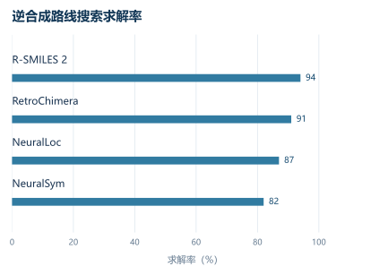


# RetroChimera｜结合互补预测方法提升逆合成可靠性

# 00. 引言：这篇论文想解决什么

计算机辅助逆合成（retrosynthesis）的基本流程已经相当稳定：给定目标分子，单步逆合成模型提出若干前体，搜索算法不断递归展开，直到叶节点都落入可购买或可获得的砌块集合。真正的问题逐渐从“模型能不能提出反应”转向三个更难的要求：

1. **常见反应要稳定地做对**；
2. **罕见但战略价值高的反应不能完全丢失**；
3. **搜索过程中不能靠大量化学上不合理的预测虚增求解率**。

这也是为什么单步模型几个百分点的误差，在多步路线中会被迅速放大。此前 Syntheseus 的系统性重评已经指出，逆合成领域的模型排名会受到数据处理、基准设置和评价协议显著影响，单纯比较某个固定测试集上的最高准确率并不足以判断实际路线规划能力。 另一篇 2024 年的观点文章则进一步指出，纯数据驱动逆合成在复杂实际场景中仍存在明显短板，化学先验和专家知识仍有重要价值。

RetroChimera 给出的回答很有意思：作者没有试图设计一个“万能”的单模型，而是承认不同建模范式天然带有不同的**归纳偏置（inductive bias）**，并把这种差异直接转化为性能来源。

它组合了：

- 一个受反应模板约束的图编辑模型 NeuralLoc；
- 一个从头生成反应物的序列模型 R-SMILES 2；
- 一个根据“哪个模型、排在第几名、是否形成共识”学习投票权重的排序集成器。

因此这篇论文真正研究的主题可以概括为：

> **逆合成模型的错误是否具有可利用的结构，以及能否通过组合不同错误模式，比继续强化单一模型获得更可靠的化学预测。**

论文发表于 2026 年 9 月 21 日的 *Nature*，官方代码和 USPTO/Pistachio 权重已经公开。   
论文主体、图表和方法细节均来自用户提供版本。

---

# 01. 背景问题：为什么这件事难

## 1.1 单步准确率不是逆合成真正的目标

假设目标分子为 $$P$$，单步模型输出可能的反应物集合：

$$
R_1,R_2,\ldots,R_k
$$

传统指标是 Top-$$k$$ 准确率：

$$
\mathrm{Acc@k}
=
\frac{\text{真实记录反应物出现在前 }k\text{ 个预测中的样本数}}
{\text{总样本数}}
$$

这个指标有一个根本问题：

**数据库通常只记录“实际做过的那条路线”，并没有穷举所有化学上合理的路线。**

因此：

- 模型提出 A；
- 专利里记录 B；
- A 可能同样合理，甚至实验化学家更愿意选择 A；
- Top-$$k$$ 指标仍会把 A 计为错误。

这也是论文为什么专门加入盲法化学家评价，而没有把“更高 Top-$$k$$”直接等同于“更好的化学”。

---

## 【背景知识：模板法和生成法到底差在哪里】

目前单步逆合成可以粗略理解为两类。

| 范式 | 核心思路 | 优势 | 典型问题 |
|---|---|---|---|
| 模板/编辑方法 | 选择已知反应变换，然后作用到目标分子 | 化学约束强、很少胡乱改结构 | 新反应类型难覆盖，模板定位存在歧义 |
| 从头生成方法 | 将目标分子的字符串映射为反应物字符串 | 灵活、可预测训练集中未明确出现的模板 | 可以产生不存在的键型、错误拷贝、化学幻觉 |

例如模板模型相当于：

> “我知道 Suzuki 偶联的逆变换长什么样，现在判断应该断哪根键。”

生成模型则更接近：

> “根据整个目标结构直接生成一套可能的反应物。”

这里存在一个非常重要的互补性：

$$
\text{模板模型：偏保守}
$$

$$
\text{生成模型：偏灵活}
$$

作者真正利用的，就是两者**错误相关性不高**这一事实。

---

## 1.2 “罕见反应问题”其实同时包含两个问题

论文特别强调 rare reaction，但需要区分：

### 情况 A：模板存在，但训练样本很少

传统模板分类器通常给每个模板配置独立分类权重。

如果模板只有两三个样本：

$$
\text{template}_j
\rightarrow
\mathbf w_j
$$

它基本没有机会学好 $$\mathbf w_j$$。

### 情况 B：模板在训练集中完全不存在

这时模板分类器原则上无法选择它。

因此模板模型需要解决的是**少样本迁移**，生成模型承担更多**未见变换泛化**。

RetroChimera 的设计正好对应这两层问题。

---

# 02. 方法核心：作者到底做了什么

整套系统可以写成：

$$
P
\rightarrow
\begin{cases}
\text{NeuralLoc}\\
\text{R-SMILES 2}
\end{cases}
\rightarrow
\text{候选反应集合}
\rightarrow
\text{学习式排序集成}
\rightarrow
R_{1:k}
$$

论文第 31 页图 1 给出了这个结构：两个模型独立产生候选，在**分子级结果空间**汇合，最后完成重新排序，而没有要求两个模型共享输出表示。

## 2.1 NeuralLoc：给模板模型增加“理解模板”和“定位模板”的能力

传统模板分类器存在两个明显问题：

### 问题一：模板之间几乎不能共享知识

传统形式近似：

$$
s_j=\mathbf h_P^\top \mathbf w_j
$$

其中 $$\mathbf w_j$$ 只是第 $$j$$ 个模板的自由参数。

两个化学变换即使非常相似：

- Suzuki 偶联模板 A；
- Suzuki 偶联模板 B；

模型也很难直接共享其化学结构信息。

NeuralLoc 将模板本身编码成图：

$$
\mathbf h_{T_j}
=
\mathrm{GNN}_{tpl}(T_j)
$$

于是模板分数变成：

$$
s_j
=
\mathbf h_P^\top
\mathbf h_{T_j}
$$

模板之间开始通过共同的图编码器共享表示。

这正是它能够从很少模板实例中学习的重要原因。

---

### 问题二：一个模板可能在目标分子上匹配多个位置

例如某个模板能够同时匹配目标上的两个相似芳环位置。

传统流程只能得到：

$$
T + P
\rightarrow
\{R_a,R_b\}
$$

模板本身无法告诉模型哪一个更合理。

NeuralLoc 因此加入第二个任务——**定位（localization）**。

对模板左侧原子 $$v$$ 和目标分子原子 $$u$$，利用节点表示计算：

$$
l_{v,u}
=
\left(
\mathbf h^{tpl}_v
\right)^\top
\mathbf h^{in}_u
$$

再归一化成匹配概率。

最终输出分数为：

$$
s_{\mathrm{final}}
=
s_{\mathrm{clf}}
+
w_{\mathrm{loc}}s_{\mathrm{loc}}
$$

论文中：

$$
w_{\mathrm{loc}}=2.25
$$

因此 NeuralLoc 同时回答：

> 用什么反应规则？

以及：

> 规则应该作用在哪个位置？

论文第 32 页图 2 对这个过程展示得非常直观：同一个模板有两个合法图匹配，但定位分支将两个候选的对数分数区分为约 $$-0.28$$ 和 $$-2.03$$，从而把更合理的位点排到前面。

---

## 2.2 R-SMILES 2：强化版从头生成模型

这一部分的方法创新程度相对低，更接近一套强工程基线。

模型使用编码器—解码器变换器（Transformer）：

$$
P_{\mathrm{SMILES}}
\rightarrow
\text{Transformer}
\rightarrow
R_{\mathrm{SMILES}}
$$

核心仍是标准交叉熵：

$$
\mathcal L
=
-\sum_t
\log
p(y_t|y_{<t},P)
$$

关键工程修改包括：

- 根对齐分子字符串表示（Root-aligned SMILES）；
- 分组查询注意力；
- 均方根归一化预归一结构；
- SwiGLU 前馈层；
- 改进束搜索终止逻辑。

其中真正对反应建模影响最大的仍然是**根对齐表示**。

普通 SMILES 中，同一分子的字符串排列可以变化很大。根对齐之后：

$$
\text{Product SMILES}
\leftrightarrow
\text{Reactant SMILES}
$$

字符串对应关系更紧，编辑距离降低，模型可以把容量更多用于学习化学变化，而非学习字符串重新排列。

作者针对不同数据集使用：

- USPTO-50K：20 倍增强；
- USPTO-FULL：5 倍；
- Pistachio：10 倍。

---

## 2.3 RetroChimera：在“分子结果空间”做学习式投票

这里才是整篇论文最重要的算法思想。

第 $$i$$ 个模型第 $$k$$ 名预测记为：

$$
r_{i,k}
$$

某个候选反应 $$r$$ 的集成分数：

$$
\boxed{
\mathrm{score}(r,\theta)
=
\sum_{i=1}^{m}
\sum_{k=1}^{k_{\max}}
\mathbf 1[r=r_{i,k}]
\theta_{i,k}
}
$$

其中：

- $$i$$：哪个模型；
- $$k$$：模型内部排名；
- $$\theta_{i,k}$$：该模型该排名的投票权重。

假设：

- R-SMILES 2 把反应 A 排第 2；
- NeuralLoc 把 A 排第 4；

那么：

$$
S(A)
=
\theta_{\mathrm{gen},2}
+
\theta_{\mathrm{edit},4}
$$

如果反应 B 只有生成模型排第 1：

$$
S(B)
=
\theta_{\mathrm{gen},1}
$$

模型会自己学习：

$$
\theta_{\mathrm{gen},2}
+
\theta_{\mathrm{edit},4}
\quad
\text{是否应该大于}
\quad
\theta_{\mathrm{gen},1}
$$

所以“两个模型都同意”是证据，但不是硬规则。

这是一个很重要的设计取舍。

如果规定：

$$
\text{共识候选永远优先}
$$

虽然幻觉会下降，却可能抹掉只有生成模型才能提出的真正罕见反应。

RetroChimera 使用**软共识**。

---

# 03. 关键机制拆解：最值得理解的技术点

## 3.1 为什么异构模型集成会有效：关键不是模型数量，是错误不相关

扩展数据图 1 很说明问题。

作者把多个 USPTO-50K 模型两两组合后发现：

> 几乎所有模型对组合都能提高性能。

甚至较弱 GLN 与较强 R-SMILES 组合，也能让后者 Top-5 提高约 1.5 个百分点。

但两个方法非常相似的模型组合：

- 两个 R-SMILES；
- 两类标准模板模型；

收益明显变小。

从统计角度看，集成收益取决于：

$$
\mathrm{ErrorCorrelation}(M_1,M_2)
$$

而不仅是：

$$
\mathrm{Accuracy}(M_1),
\mathrm{Accuracy}(M_2)
$$

这就是论文题目里“diverse inductive bias”的真正含义。

### 两个子模型分别被什么约束？

**NeuralLoc：**

$$
\text{已知模板}
+
\text{局部图编辑}
$$

它很难生成完全离谱的反应，但容易遗漏模板库之外的化学，并且局部模式可能无法充分描述远程电子效应。

**R-SMILES 2：**

$$
\text{完整目标结构}
\rightarrow
\text{自由生成完整反应物}
$$

它可以利用全局环境，也可以突破模板限制，但偶尔会：

- 错误改变环结构；
- 重复反应物；
- 产生不合理键型；
- 形成反应幻觉。

扩展数据图 5 就展示了 R-SMILES 2 将目标中的环错误复制成另一种键型，而 NeuralLoc 因为没有对应合法模板而没有提出该候选；集成后这个错误被自动降权。

这可以写成：

$$
\boxed{
\text{一个模型负责拓展搜索空间，
另一个模型负责提供结构性约束}
}
$$

---

## 3.2 排名相关权重为什么比“模型 A 权重 0.6，模型 B 权重 0.4”更合理

作者没有只学习：

$$
\theta_A,\theta_B
$$

而是学习：

$$
\theta_{A,1},\theta_{A,2},\ldots
$$

$$
\theta_{B,1},\theta_{B,2},\ldots
$$

扩展数据图 1b 中甚至出现两条权重曲线交叉：

- 高排名时，生成模型更可信；
- 排名下降后，编辑模型相对更可信。

这与后面的专家实验高度一致：

> R-SMILES 2 的化学质量随排名下降得明显更快。

因此“模型可靠度”实际上是：

$$
\mathrm{Reliability}
=
f(\text{model},\text{rank})
$$

而不是模型级别的单一常数。

---

### 排序权重怎么训练？

目标是真实反应 $$r^+$$ 应排在错误候选 $$r^-$$ 前面：

$$
L_{\mathrm{rank}}
=
\sigma
\left(
\frac{
S(r^-)-S(r^+)+\epsilon
}{T}
\right)
$$

理解方式很简单。

如果：

$$
S(r^+) > S(r^-)
$$

损失较小。

如果：

$$
S(r^-) > S(r^+)
$$

损失增大。

随着温度 $$T$$ 逐渐降低，它越来越接近一个离散判断：

$$
\mathbf 1[
S(r^-)>S(r^+)
]
$$

作者还要求每个模型的权重曲线**单调下降且为凸函数**：

$$
\theta_{i,k}
>
\theta_{i,k+1}
$$

而且前几名的权重差应该比后几十名更明显。

这其实是在给学习排序加入一个非常合理的先验：

> 第 1 名和第 2 名的区别，通常比第 49 名和第 50 名更有信息。

---

## 3.3 NeuralLoc 的真正创新：把“反应模板”从标签变成对象

传统模板分类：

$$
P\rightarrow ID_{template}
$$

模板 ID 本质上只是类别编号。

NeuralLoc 变成：

$$
(P,T)
\rightarrow
\text{compatibility}
$$

即让模型真正读取模板结构。

模板图包含：

- 反应前图；
- 反应后图；
- 原子映射边；
- SMARTS 匹配条件；
- 左右方向信息。

这带来了一个非常重要的归纳偏置：

$$
\text{相似化学变换}
\Rightarrow
\text{相似模板表示}
$$

所以“模板只有 3 个训练样本”不等于“模型只知道这 3 个样本”。

它还继承了其他模板的结构知识。

不过需要明确：

> 这并不是严格意义上的少样本元学习。

对于真正训练中不存在的模板，NeuralLoc 仍然受模板库限制。作者在 Pistachio/USPTO-FULL 上甚至只训练出现至少两次的模板。

论文中所谓“rare reaction capability”，很大一部分来自：

$$
\text{NeuralLoc 的少样本模板迁移}
+
\text{R-SMILES 2 的模板外泛化}
$$

---

# 04. 实验验证：结果到底说明了什么

## 4.1 USPTO：集成主要改善候选覆盖率，Top-1 并非绝对优势

USPTO-50K：

| 模型 | Top-1 | Top-5 | Top-50 |
|---|---:|---:|---:|
| R-SMILES 2 | 56.9% | 86.9% | 96.4% |
| NeuralLoc | 53.3% | 80.7% | 93.8% |
| RetroChimera | 56.7% | **87.6%** | **97.9%** |

值得注意：

**RetroChimera 的 Top-1 甚至略低于 R-SMILES 2。**

它真正明显提升的是：

$$
k>1
$$

这说明集成的核心价值是让合理的不同反应策略更靠前，而不是简单提升“唯一首选答案”。

USPTO-FULL 也类似：

- RetroChimera Top-1：51.4%；
- RetroWISE：52.3%；
- RetroChimera 从 Top-3 开始占明显优势；
- Top-50 达到 85.6%。

因此把论文概括成“单步预测准确率刷新纪录”会漏掉真正重点。

更准确的理解是：

$$
\boxed{
\text{RetroChimera 提升的是高质量候选集合的覆盖能力}
}
$$

这对多步搜索反而更加重要。

---

## 4.2 Pistachio 时间切分：这里比 USPTO 更有实际意义

作者使用了一个设计得相当严格的 Pistachio 测试集：

- 训练数据截止 2023 年；
- 测试反应来自 2024 年新增数据；
- 去除与训练目标过于相似的分子；
- 最终保留 146,393 条反应。

这比随机切分更接近真实部署：

$$
\text{过去数据训练}
\rightarrow
\text{预测未来化学}
$$

论文第 33 页图 3a 中：

> RetroChimera 用前 10 个候选达到 R-SMILES 2 需要约 50 个候选才能达到的召回水平。

这是非常有实际意义的。

因为搜索系统每展开一个候选，都意味着新的树节点和计算成本。

如果：

$$
50\rightarrow10
$$

仍能保留类似覆盖率，搜索的有效分支因子会明显下降。

---

## 4.3 罕见反应实验真正证明了什么

图 3e 将测试样本按模板训练频次切分。

观察非常符合模型结构：

### 模板频率为 0 或 1

R-SMILES 2 明显占优。

这是因为 NeuralLoc 本身无法直接使用未知模板。

### 有少量模板样本

NeuralLoc 很快追上甚至超过生成模型。

这说明模板编码器确实产生了跨模板知识共享。

### 高频模板

RetroChimera 接近饱和。

作者因此称其类似：

> “软反应数据库”。

这个说法是有依据的：对于已有大量先例的反应，模型已经接近把数据库知识检索出来。

但需要避免一个过度解读：

$$
\text{rare template}
\neq
\text{novel chemistry}
$$

论文证明的是**对低频训练类别更鲁棒**，没有证明能够发现新的反应机理。

---

## 4.4 两个模型真的学到了不同“化学专长”

图 3c 很有价值。

R-SMILES 2 更擅长：

- 杂环形成；
- 多反应中心；
- NameRxn 无法分类的反应。

NeuralLoc 更擅长：

- 氧化；
- 官能团互变。

而 RetroChimera 在不同类别上通常接近两个子模型中表现较好的那个。

这就是作者所说的：

$$
\text{类似专家混合模型}
$$

区别是没有显式门控网络。

可以理解为：

$$
\text{输入依赖的隐式门控}
\approx
\text{两个模型各自产生什么、排在哪里、是否形成共识}
$$

这也是整篇论文中很漂亮的一点。

---

## 4.5 “化学家更喜欢模型预测”应该怎么理解

这是论文最吸睛，也最容易被误读的结果。

### 成对盲测

- 9 名博士级有机化学家；
- 599 次比较；
- 比较测试集反应、RetroChimera 及子模型等；
- 专家不知道候选来源。

在 RetroChimera 第一名与数据集记录反应不同的情况下：

$$
P(
\text{chemist prefers RetroChimera}
)
\approx64\%
$$

并达到统计显著。

这证明了：

> 数据集记录反应并不是唯一合理答案，Top-$$k$$ ground truth 指标确实低估了模型质量。

它没有证明：

> 模型已经比人类化学家更会设计合成路线。

实验比较的是**模型候选与数据库记录反应的专家偏好**，并没有让模型与化学家独立完成完整路线设计后进行全面对决。

“chemist-aligned”在这篇论文里的操作性定义，本质是：

$$
\text{专家偏好}
+
\text{较低幻觉率}
$$

范围需要控制在这里。

---

## 4.6 幻觉评价比 Top-k 更重要

作者又进行了点式评价：

- 6045 个评价；
- 2555 个独立反应；
- 5 名专家；
- 标签：合理、边界、幻觉。

RetroChimera 的幻觉率显著低于 NeuralSym。

更重要的是：

$$
\text{Consensus}
=
\text{两个子模型都提出过的反应}
$$

这部分幻觉率进一步下降到极低水平。

扩展数据图 3 还显示：

$$
\text{RetroChimera score}
\uparrow
\quad\Rightarrow\quad
\text{hallucination rate}
\downarrow
$$

最高分位候选的幻觉率约只有几个百分点。

这说明 ensemble score 不只是排序工具，还隐含了一个相当有用的**置信度信号**。

---

## 4.7 多步搜索：最重要的结果其实不是求解率

SimpRetro 上，RetroChimera 在较大时间预算下接近：

$$
100\%\text{ solve rate}
$$

但论文自己很谨慎地指出：

> 求解率可以被错误反应人为抬高。

因此后面 PistachioHard 实验更加重要。

无过滤搜索中：

*按文章现有表格重绘；找到路线不等于路线经过专家验证或一定可合成。*

| 模型 | 求解率 |
|---|---:|
| R-SMILES 2 | **94%** |
| RetroChimera | 91% |
| NeuralLoc | 87% |
| NeuralSym | 82% |

只看这个表，甚至会觉得 R-SMILES 2 更好。

专家逐步检查 10 条高难路线后：

| 模型 | 合理步骤比例 | 完全通过路线 |
|---|---:|---:|
| RetroChimera | **96.9%** | **9/10** |
| R-SMILES 2 | 89.2% | 5/10 |
| NeuralLoc | 91.8% | 4/10 |
| NeuralSym | 78.5% | 2/10 |

这组结果是整篇论文最值得记住的实验之一。

它说明：

$$
\boxed{
\text{更高 solve rate 完全可能来自更多错误边}
}
$$

在搜索树中，一个错误反应也可以让模型“成功走到砌块”。

所以：

$$
\text{路线求解}
\neq
\text{路线可合成}
$$

---

## 【背景知识：为什么错误会在多步路线中快速累积】

假设每一步独立正确概率为 $$p$$。

一条 $$n$$ 步路线全部正确的概率近似：

$$
P_{\mathrm{route}}
=
p^n
$$

例如：

$$
p=0.9
$$

五步以后：

$$
0.9^5
\approx0.59
$$

如果单步提高到：

$$
p=0.97
$$

则：

$$
0.97^5
\approx0.86
$$

这就是为什么论文中：

- 96.9% 单步合理率；
- 9/10 整条路线通过；

具有远比几个百分点 Top-1 提升更大的实际含义。

---

## 4.8 幻觉过滤器揭示了另一个重要方向

作者训练了：

- 正向反应模型；
- 可行性模型；
- 两者与简单化学描述符组合后的分类器。

专家标注数据上：

$$
\mathrm{AUC}_{feasibility}=0.76
$$

$$
\mathrm{AUC}_{forward}=0.81
$$

$$
\mathrm{AUC}_{combined}=0.88
$$

选择的工作点约能：

- 拦截 75% 幻觉；
- 错杀约 15% 合理反应。

这部分结果意味着未来实际逆合成系统可能更接近：

$$
\boxed{
\text{proposal}
\rightarrow
\text{verification}
\rightarrow
\text{search}
}
$$

而不是单个逆合成网络包办全部工作。

---

# 05. 这项工作的真正价值

## 5.1 它改变了“模板模型和生成模型谁更好”的提问方式

过去大量工作围绕：

$$
\text{template-based}
\quad \mathrm{vs}\quad
\text{template-free}
$$

RetroChimera 的结果表明，更有价值的问题是：

$$
\boxed{
\text{它们分别在哪些区域犯什么错误？}
}
$$

只要错误具有互补性，就可以构建更强系统。

这是一个明显的范式变化。

---

## 5.2 论文最有价值的创新可能不是某个神经网络层

R-SMILES 2 使用的大量组件本身都不是新技术。

NeuralLoc 的创新更实质，但仍属于模板预测路线的持续改进。

真正把论文层级拉高的是：

$$
\text{异构归纳偏置}
+
\text{学习式结果融合}
+
\text{时间外推}
+
\text{药企内部数据}
+
\text{专家评价}
+
\text{多步路线评价}
$$

它把研究目标从：

> “在 USPTO 上提高 1%”

推进到：

> “模型产生的路线是否更接近合成化学家的实际判断”。

这比单纯模型结构升级更重要。

---

## 5.3 对生成式药物设计也有直接启示

目前很多生成式分子设计工作把“可合成性”压缩成：

$$
\mathrm{SA\ score}
$$

或者让一个逆合成模型简单判断：

$$
\text{solved / unsolved}
$$

RetroChimera 明确说明这种做法风险很大。

如果规划模型存在幻觉：

$$
\text{高 solve rate}
$$

甚至可能代表：

$$
\text{更容易用错误反应构造假路线}
$$

因此生成式药物设计中的合成约束，更合理的形式可能是：

$$
\text{route existence}
+
\text{step confidence}
+
\text{model consensus}
+
\text{feasibility filtering}
$$

这比一个二元“可合成”标签信息量高得多。

---

## 5.4 工业价值在于“低风险地扩大搜索空间”

RetroChimera 最有意思的行为可以写成：

$$
\text{模板模型负责下限}
+
\text{生成模型负责上限}
$$

模板模型提供稳定、低幻觉的基本盘；

生成模型保留：

- 少见反应；
- 多反应中心；
- 模板库没有覆盖的转换。

集成器避免为了降低幻觉直接把生成模型硬过滤掉。

这种系统设计对实际药化路线规划相当合理。

---

# 06. 局限与需要验证的点

## 6.1 “化学家对齐”距离实际实验成功仍有明显距离

专家认为合理：

$$
\neq
$$

实验能够高收率、选择性良好地完成。

论文没有进行系统性的前瞻湿实验验证。

并且图 4 的路线明确指出：

> 该研究没有预测试剂、溶剂和具体反应条件。

因此 RetroChimera 当前预测的是：

$$
\text{reaction topology}
$$

还没有完整解决：

$$
\text{reaction deployment}
$$

这一层问题。

---

## 6.2 多步专家实验只有 10 个目标

PistachioHard 总体有 1784 个困难目标，但精细专家路线评价只选了其中 10 个。

而且目标还满足：

- 所有模型均能在 5 分钟内找到路线；
- 路线中包含指定类型的非平凡反应。

因此：

$$
9/10
$$

是很强的定性证据，但不能直接解释为所有困难化学空间都有约 90% 的完整路线可靠率。

这是需要扩大验证的部分。

---

## 6.3 “少样本反应学习”仍高度依赖模板体系

NeuralLoc 的少样本优势很清楚。

但真正零样本模板仍主要依赖生成模型。

所以最脆弱的区域依然是：

$$
\text{训练集没有先例}
+
\text{化学空间远离专利数据}
$$

论文自己也明确提到天然产物等远离训练分布区域仍容易出现幻觉。

---

## 6.4 集成器其实相当简单

目前：

$$
\theta_{i,k}
$$

只依赖：

- 模型身份；
- 输出排名。

它并不知道：

- 当前是什么反应类型；
- 分子的电子环境如何；
- 模板支持度是多少；
- 是否属于明显分布外样本。

论文称它表现得类似专家混合模型，这在现象上成立，但它没有显式的输入条件门控：

$$
\theta
\neq
f(P)
$$

未来很自然的一步是：

$$
\theta_{i,k}(P)
$$

即根据目标结构动态决定更加信任哪一个模型。

当然，这也会带来更高的过拟合风险。

---

## 6.5 完整复现存在数据壁垒

代码目前已经公开，并支持从：

- 去重；
- 数据切分；
- 模板提取；
- R-SMILES 数据增强；
- 图特征预处理；
- 模型训练；
- 集成优化；

走完整流程。官方仓库也提供了相应脚本。

但：

- Pistachio 为商业数据库；
- Novartis 数据不公开；
- GSK 数据不公开；
- GSK 内部训练权重也不公开。

因此公开环境可以很好复现 USPTO 结果和使用公开 Pistachio checkpoint，但很难独立验证论文最重要的工业分布迁移结论。

---

# 07. 总结与延伸探讨

我对这篇工作的核心判断是：

> **RetroChimera 最重要的贡献不是证明“集成比单模型强”，而是证明逆合成领域中不同建模范式存在稳定、可解释、可利用的错误互补性。**

最值得记住的有三个技术点。

### 第一，归纳偏置可以被当作系统组件设计

模型不需要都趋向同一种架构。

$$
\text{强约束模型}
+
\text{高自由度模型}
$$

本身就是有价值的组合。

---

### 第二，“共识”是一种非常强的化学置信信号

两个机制完全不同的模型独立得到相同反应：

$$
P(r|M_1,M_2)
$$

明显比单模型置信分数更值得信任。

这与多模型科学计算中的交叉验证思想很接近。

---

### 第三，逆合成评价需要从“检索标准答案”向“评价化学合理性”迁移

这篇论文实际上暴露了一个长期存在的问题：

$$
\mathrm{Top-k\ recall}
$$

测的是：

> 能否恢复数据库记录。

真正关心的是：

$$
\mathrm{chemical\ utility}
$$

包括：

- 可行性；
- 选择性；
- 路线长度；
- 试剂可获得性；
- 条件鲁棒性；
- 安全和放大难度。

RetroChimera 只是开始把评价体系向这个方向推进。

---

# 08. 展望

## 8.1 最脆弱的假设是什么？

我认为是：

$$
\boxed{
\text{两个模型在未来分布上的错误仍保持互补}
}
$$

当前 ensemble 权重由验证集学习。

如果进入一个完全不同的化学领域，例如某类新催化体系，两种模型可能同时继承训练数据中的系统性偏差：

$$
M_1\text{错}
\quad\land\quad
M_2\text{也错}
$$

此时“共识”甚至可能产生**高置信度共同错误**。

所以需要研究：

$$
\text{consensus confidence}
$$

在真正强分布偏移下是否仍然校准。

---

## 8.2 如果只有一周，最值得复现什么？

不需要重跑整篇 Nature。

推荐直接验证论文最核心命题：

### USPTO-50K：异构模型是否确实比同构模型更适合集成

使用官方 checkpoint 即可：

$$
\text{NeuralLoc}
+
\text{R-SMILES 2}
$$

比较：

$$
\text{单模型}
$$

$$
\text{简单 reciprocal voting}
$$

$$
\text{论文学习式 voting}
$$

重点输出三张图：

1. Top-$$k$$ 曲线；
2. 按模板频率切分的准确率；
3. 两模型共识候选与单模型独有候选的化学合理率。

第三项如果没有专家，可以暂时用：

$$
\text{forward score}
+
\text{reaction feasibility score}
$$

作为近似指标。

这已经足够验证 RetroChimera 最主要的科学假设。

官方代码已经把模型训练、预测导出和 `optimize_ensembles.py` 集成优化流程开放出来，工程成本相对可控。

---

## 8.3 如果反对这篇论文，我会怎么构造反例？

最直接的反例不是找一个模型预测错的普通分子，而是构造：

$$
\boxed{
\text{两种归纳偏置都会系统性失败的任务}
}
$$

例如设计一个测试集：

- 局部反应中心和训练集高度相似；
- 真正的选择性由远程电子效应或立体效应决定；
- 数据库中存在系统性的错误或偏好；
- 正确反应属于低先例甚至新反应体系。

这样：

NeuralLoc 可能因为局部模板匹配而高置信度选错位置；

R-SMILES 2 又可能因为训练分布偏差生成同一个错误答案。

于是得到：

$$
\text{错误共识}
\rightarrow
\text{集成反而进一步提高错误置信度}
$$

如果 RetroChimera 在这种专门构造的压力测试中仍然能够保持校准，才说明“异构归纳偏置集成”具有比当前论文更强的普适性。

---

这篇文章从方法创新程度看，没有提出一个类似扩散模型那样全新的逆合成生成范式；从**系统设计和评价范式**看，它的重要性反而更高。它把逆合成研究从“寻找一个最强单模型”推进到了“设计一组错误互补、可验证、能被搜索系统安全调用的模型”。这条路线很可能比继续围绕单一 Top-1 指标迭代模型，更接近真正可用于药物研发的计算合成规划系统。


