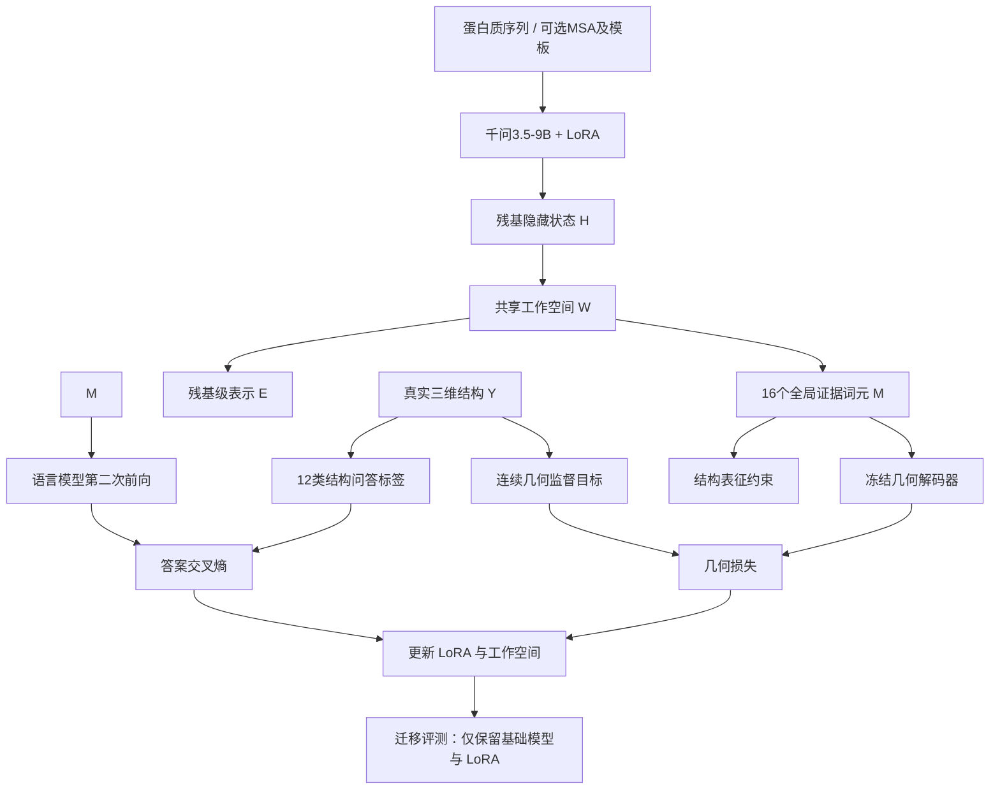

> 图表数据由原对话转换为表格。


# Fold2Reason｜从蛋白质结构学习到通用推理能力迁移

2026年9月30日 · arXiv 预印本 · 上海交通大学等 · Yong Liu 等

**论文：** Does Learning Protein Folding Generalize to Broader Reasoning?（学习蛋白质折叠能否迁移到更广泛的推理任务？）

**代码：** [GENTEL-lab/Fold2Reason](https://github.com/GENTEL-lab/Fold2Reason)

## 00\. 引言：这篇论文想解决什么

大语言模型（Large Language Model，LLM）的能力主要来自自然语言、代码和数学等训练数据。然而，**语言数据中的统计规律，能否让模型真正学会理解三维空间、几何约束以及复杂对象之间的结构关系？**

这是一个值得探索的问题。

近年来，大模型推理能力的提升主要围绕数学和代码展开，因为这些领域具有明确的正确答案，能够通过程序自动验证。但其他领域的能力提升往往难以稳定迁移。

例如，2026年国际机器学习大会的一项研究发现，数学推理任务上的性能提升并不必然迁移到科学问答、代码和其他通用任务，迁移效果还取决于后训练方式及模型参数更新的分布。

这篇论文提出了一个不同的思路：

**与其继续构造语言形式的推理题，能否直接从真实世界的科学结构中提取训练信号，让模型学习隐含其中的空间关系？**

作者选择了蛋白质折叠问题，原因很有代表性。

一条蛋白质序列对应一个三维结构。只要拥有参考结构，就可以从中构造大量可精确验证的问题，例如：

- 第23号与第147号残基在空间上是否接触？
- 两组残基中，哪一组距离更近？
- 两段蛋白质骨架的方向是否平行？
- 一组空间点的排列具有怎样的手性？
- 哪个候选结构同时满足给定的多个几何约束？

这些问题的答案由三维坐标确定，无需人工标注，也不依赖另一个语言模型生成答案。

作者据此提出两个核心组件：

**FoldingCorpus：蛋白质结构问答数据集**

将已知蛋白质结构转化为12类可验证的几何与拓扑推理问题。

**Fold2Reason：结构监督驱动的语言模型后训练框架**

使用离散结构问答与连续三维几何两种监督信号训练模型，并考察其能否迁移到蛋白质以外的任务。

论文给出了一个值得关注的结果：

原始模型综合准确率

# 45.09%

后训练模型综合准确率

# 48.33%

绝对提升

# \+3.23 pp

基于千问3.5-9B、1000条训练蛋白质、3个独立随机种子的结果；pp 表示百分点。

更重要的是，这些提升来自蛋白质结构任务的训练，但下游评测覆盖空间、图、科学及混合推理任务，推理时无需输入蛋白质序列，也无需加载专用的几何模块。

不过，本文必须区分三个命题：

1. **蛋白质结构监督能改善通用推理基准的表现**：实验提供了较直接的证据。
2. **模型因此学会了更通用的几何推理机制**：具有合理性，但尚未得到机制层面的证明。
3. **语言模型学会了高精度蛋白质折叠**：目前的结构预测结果并不支持这个结论。

第二点和第三点的区别，是理解整篇论文的关键。

## 01\. 背景问题：为什么蛋白质结构可能成为推理训练数据

### 1.1 【背景知识：可验证监督与结构关系学习】

传统语言模型通过预测下一个词元来学习数据分布：

$$
\mathcal L_{\mathrm{LM}}
=-\sum_t\log P_\theta(x_t\mid x_{<t})
$$

这个目标能够让模型掌握丰富的语言规律、事实知识和部分推理能力。

但仅从这种训练目标出发，并不能保证模型会系统学习某类结构约束。

以空间问题为例，模型可以记住“大多数蛋白质主链具有一定连续性”，却未必能判断：

- 两个序列位置相距很远的残基是否在三维空间中接近；
- 一个空间构型经过旋转后是否与原构型等价；
- 多个局部距离约束能否同时满足。

作者的核心假设是：

**如果训练样本要求模型同时处理距离、接触、方向、手性和全局约束，就可能促使模型改善对结构性信息的利用，并将部分能力迁移到其他领域。**

这里最有价值的特点是监督的可验证性。

给定真实坐标 $$\mathbf c_i,\mathbf c_j$$，两个残基的距离可以直接计算：

$$
d_{ij}=\|\mathbf c_i-\mathbf c_j\|_2
$$

如果规定空间接触阈值为8 Å，那么：

$$
y_{ij}=\mathbb I(d_{ij}<8\ \text{Å})
$$

其中 $$\mathbb I$$ 是指示函数，满足条件时取1，否则取0。

由此得到的答案来自确定的几何计算，能够自动检查是否正确。

### 1.2 【背景知识：结构预测与结构推理的差别】

需要进一步区分两种任务。

**蛋白质结构预测**要求模型根据氨基酸序列预测完整三维坐标：

$$
\text{Sequence}\longrightarrow
Y\in\mathbb R^{L\times4\times3}
$$

其中 $$L$$ 为残基数，4表示主链上的 N、Cα、C、O 四个原子，3表示三维坐标。

**结构推理**则可以只要求模型判断部分几何关系：

$$
\text{Sequence}+\text{Question}
\longrightarrow \text{Structural Answer}
$$

例如，判断一对残基是否接触，比准确预测全部原子坐标的任务空间更小。

这意味着模型有可能学会回答某些结构问题，却仍然无法重建准确的蛋白质整体构象。

Fold2Reason 正是利用这一点，将复杂的连续三维预测问题拆解成大量较容易自动监督的离散判断任务，同时保留一个连续几何分支作为补充。

这一设计也为后续实验提出了一个重要问题：

**模型性能改善，究竟来自几何重建能力，还是来自结构问答训练对原有语言模型的调整？**

论文的消融实验实际上给出了相当明确的答案：主要贡献来自结构问答监督。

## 02\. 方法核心：作者到底做了什么

论文的整体流程如第4页图2所示，可以划分为数据构造、残基表征、双重监督和参数迁移四个部分。

### 2.1 FoldingCorpus：从已知结构中提取可验证问题

这是整篇论文最有价值的设计之一。

作者使用 OpenFold 的单体短蛋白质数据，保留已知的蛋白质骨架坐标，并构建以下数据集：

| 数据划分 | 蛋白质数 | 结构问答数 |
|--------|--------|--------|
| 训练集 | 1,000 | 12,000 |
| 开发集 | 100 | 1,200 |
| 冻结测试集 | 100 | 1,200 |
| 合计 | 1,200 | 14,400 |

训练蛋白质的长度为29—199个残基，平均144.42个残基。序列聚类划分使用30%序列一致性和80%覆盖率作为条件，但后续仍发现更广泛的同源性和模板证据隔离问题。

每条蛋白质构造12种结构问答：

| 任务类别 | 数量 | 学习内容 |
|--------|--------|--------|
| 短、中、长程及任意接触 | 4 | 空间邻近关系 |
| 距离排序与质心距离 | 3 | 相对距离、整体位置 |
| 片段方向、局部方向、手性 | 3 | 空间定向与几何关系 |
| 多重约束判断 | 1 | 同时满足多个距离条件 |
| 三维结构摘要检索 | 1 | 在32个候选摘要中识别目标 |

对应附录第17页表5。

其中9道是二分类，2道是三分类，1道是32分类。

例如，假设蛋白质的第20号残基和第80号残基在序列上距离较远，却因为蛋白质折叠而相互接近。

作者就可以构造：

> 第20号与第80号残基之间的 Cα 距离是否小于8 Å？

正确答案通过参考三维结构计算获得。

**模型输入没有参考结构坐标。** 训练时可以提供蛋白质序列、多序列比对（Multiple Sequence Alignment，MSA）或结构模板证据，但目标坐标只用于计算答案和训练损失。

另外，12道题组合成一个训练样本，只有12个答案词元和1个结束词元参与离散问答损失。

这使得每条蛋白质能够以较低的答案监督成本，提供多种结构判断信号。

不过，这里有一个重要的工程取舍：

作者没有对同一条蛋白质穷举数千甚至数百万个残基对关系，而是每类结构算子只采样一道题。

因此，**FoldingCorpus 更接近结构多样性监督，而非密集的残基对监督。**

这可能避免训练样本高度冗余，也使数据集比较紧凑；但论文没有证明每条蛋白质12道题是最优配置。

### 2.2 把普通语言模型变成残基表示提取器

作者采用千问3.5-9B（Qwen3.5-9B）作为基础模型。

首先将蛋白质转换为结构化文本，在每个残基后添加一个特殊标记，用来定位对应的隐藏表示。

示意如下：

```text
蛋白质序列：M K A ... L

输入：
1 M [RES]
2 K [RES]
3 A [RES]
...
L L [RES]
```

模型经过前向传播后，提取每个残基标记位置的最后一层隐藏状态：

$$
H=f_\theta(x)_{\mathrm{res}}
\in\mathbb R^{L\times4096}
$$

其中：

- $$x$$ 是蛋白质输入；
- $$L$$ 是蛋白质长度；
- 4096是语言模型的隐藏层维度；
- $$H$$ 包含每个残基对应的上下文表征。

基础模型参数被冻结，通过低秩适配（Low-Rank Adaptation，LoRA）进行微调。

这个设计的关键在于，语言模型可以直接作为蛋白质表征编码器使用，无需额外训练独立的蛋白质语言模型。

但这里也存在一个限制：模型主要通过通用语言模型对氨基酸序列的词元表示进行学习，并没有显式注入三维旋转等变性。

### 2.3 共享工作空间：融合残基局部信息和全局结构信息

原始残基表示 $$H$$ 的维度为4096，直接用于复杂的成对几何计算成本较高。

作者因此设计了一个共享工作空间（Shared Workspace），记为 $$W_\phi$$。

$$
(E,M)=W_\phi(H)
$$

其中：

$$
E\in\mathbb R^{L\times4096}
$$

$$
M\in\mathbb R^{16\times4096}
$$

该模块承担两个不同的任务。

**第一条路径：生成残基级表示 $$E$$。**

模型将4096维的残基表示压缩至256维，并通过稀疏残基对进行信息交换。

残基对包括序列间隔为1—4的位置，以及均匀采样的长程序列位置；每条蛋白质最多保留2048个残基对。

之后再将融合后的特征投影回4096维。

这些残基对由序列索引确定，未使用真实接触关系挑选连接边，从而避免将目标答案直接编码到模型连接结构中。

**第二条路径：生成全局证据词元 $$M$$。**

作者使用16个可学习查询向量，通过注意力汇聚残基信息，形成16个全局证据词元。

它们相当于为后续语言模型准备一个固定长度的蛋白质结构信息前缀。

为什么需要这两种输出？

因为12类结构任务包含两个尺度的信息：

- 接触、距离、局部方向需要保留残基级的位置对应关系。
- 全局结构摘要、几何约束判断需要聚合整个蛋白质的信息。

使用 $$E$$ 和 $$M$$ 两种表示，就能让离散问答和连续几何重建共享同一组可训练的特征。

### 2.4 双重监督：语言答案与连续三维坐标

Fold2Reason 训练与迁移架构



依据论文第4页图2及第20—21页训练算法重构。真实坐标仅提供监督，不作为语言模型输入。

**离散问答监督。**

共享工作空间产生的16个证据词元作为前缀，输入经过相同 LoRA 适配的语言模型。

模型需要依次预测12个结构答案：

$$
\mathcal L_{\mathrm{QA}}
=-\frac{1}{|S|}
\sum_{t\in S}\log p_{\theta,\phi}
(y_t\mid M,q,y_{<t})
$$

其中 $$S$$ 是参与监督的答案位置，包括12个答案词元和结束词元。

所有问题描述及前缀位置都从损失中屏蔽。

**连续几何监督。**

残基级表示 $$E$$ 被送入一个几何解码器，预测主链原子坐标和残基间距离分布。

其几何损失由七部分构成：

$$
\begin{aligned}
\mathcal L_{\mathrm{geo}}={}&
\mathcal L_{\mathrm{coord}}
+\mathcal L_{\mathrm{pair}}
+\mathcal L_{\mathrm{contact}}\\
&+\mathcal L_{\mathrm{dist}}
+\mathcal L_{\mathrm{local}}\\
&+\mathcal L_{\mathrm{torsion}}
+\mathcal L_{\mathrm{Rg}}
\end{aligned}
$$

分别对应：

| 损失 | 约束 |
|--------|--------|
| 坐标损失 | 预测主链坐标与真实坐标接近 |
| 成对距离损失 | 残基间距离准确 |
| 接触损失 | 残基空间接触关系正确 |
| 距离分布损失 | 成对距离的离散分布合理 |
| 局部坐标系损失 | 局部骨架方向与几何正确 |
| 二面角损失 | 主链局部构象合理 |
| 回转半径损失 | 蛋白质整体紧凑程度合理 |

最终的联合目标为：

$$
\boxed{
\mathcal L
=\mathcal L_{\mathrm{QA}}
+\mathcal L_{\mathrm{geo}}
}
$$

训练时只有 LoRA 和共享工作空间更新。

这里有一个容易忽略的细节：**几何解码器经过独立预训练后，在正式后训练期间保持冻结。**

作者在第19—20页附录中明确说明，几何解码器提前使用相同1000条训练蛋白质、冻结的基础语言模型特征进行训练。

这样，正式训练时几何损失的梯度需要通过固定的解码器传回工作空间及 LoRA，不能单纯依靠重新调整几何解码器来降低损失。

## 03\. 关键机制拆解：最值得理解的三个设计

### 3.1 为什么冻结几何解码器？

这是整套方法中具有明确建模动机的设计。

假设语言模型得到的残基表示为 $$H$$，几何解码器为 $$g_\psi$$。

一般的联合训练可以写为：

$$
\min_{\theta,\phi,\psi}
\mathcal L_{\mathrm{geo}}
\left(g_\psi(W_\phi(f_\theta(x))),Y\right)
$$

这里存在一个问题：

几何预测效果改善，可能主要因为几何解码器本身学得更好了，而语言模型内部的表示并没有获得明显的结构信息增益。

作者改为固定 $$\psi$$：

$$
\min_{\theta,\phi}
\mathcal L_{\mathrm{geo}}
\left(g_{\psi^\ast}(W_\phi(f_\theta(x))),Y\right)
$$

由于 $$g_{\psi^\ast}$$ 不更新，模型只能通过调整前面的表示，使固定解码器更加容易恢复正确结构。

梯度传播可以理解为：

$$
\frac{\partial\mathcal L_{\mathrm{geo}}}{\partial\theta}
=
\frac{\partial\mathcal L_{\mathrm{geo}}}{\partial E}
\frac{\partial E}{\partial H}
\frac{\partial H}{\partial\theta}
$$

虽然几何解码器参数被冻结，但对其输入 $$E$$ 的梯度仍然保留，因此可以反向更新 LoRA。

**这个设计为语言模型增加了一个结构可解码性约束。**

但需要注意，固定的解码器自身也存在能力上限。如果其预训练性能较弱，那么它提供的监督可能只能改善局部几何信息，甚至与更准确的全局结构预测产生冲突。

后续实验正好观察到了这种现象。

### 3.2 为什么用语言模型原生输出头回答结构问题？

另一种实现思路是：在语言模型之上增加一个单独的结构分类器。

例如：

$$
\hat y_{ij}
=\operatorname{MLP}([h_i,h_j])
$$

这样可以较容易预测接触关系，但存在一个迁移问题。

如果训练主要更新这个独立分类器，那么即使结构预测成绩提高，也不能说明语言模型本身的通用能力得到增强。

Fold2Reason 使用基础语言模型原有的词表和预测头，把正确答案表达为普通词元。

例如：

```text
问题：残基 i 与 j 是否接触？
A. 接触
B. 不接触

目标答案：A
```

这样，回答结构问题时使用的语言模型参数，与后续进行图推理、科学问答时使用的参数具有直接关联。

作者希望结构问答的监督能够调整通用模型内部表示及其输出行为。

不过，这种做法也产生了一个关键混杂因素：

**模型可能只改善了对选项词元的选择和答案格式的适应，而没有真正增强底层几何计算能力。**

论文专门构建了随机结构、答案复制和标签打乱三类对照来讨论这个问题，但并未彻底排除它。

### 3.3 为什么迁移时移除全部蛋白质专用模块？

这是实验设计中最直接的一项因果约束。

训练时，模型可以使用残基标记、共享工作空间以及冻结的几何解码器。

但在通用推理评测中，作者将工作空间和几何解码器全部移除：

$$
f_{\theta_0+\Delta\theta}
$$

其中 $$\Delta\theta$$ 是后训练获得的 LoRA 参数。

因此，通用推理性能的提升必须体现在保留的语言模型参数中。

这能够避免一种常见的解释问题：模型在下游任务中调用额外结构模块，所以看起来推理更强。

但它仍然只能证明**参数更新带来了可观察的跨任务性能变化**，不能直接证明模型内部形成了可解释、可复用的几何推理算法。

例如，修改后的模型可能变得更善于选择特定选项、遵循答案约束，或者更稳定地调用原本已经具备的知识。

这些机制都需要进一步通过因果实验区分。

## 04\. 实验验证：结果到底说明了什么

### 4.1 通用推理：10个基准均获得平均提升

作者使用10个任务基准组成 General-10，覆盖空间、图结构、科学及综合推理。

下表为主实验结果，单位为准确率百分比。

| 基准任务 | 原始模型 | Fold2Reason | 提升 |
|--------|--------|--------|--------|
| FTB-Core（三维空间推理） | 36.18 | 40.26 | \+4.08 |
| SpatialViz（图像空间推理） | 26.61 | 32.71 | \+6.10 |
| VSI（视频空间理解） | 58.53 | 60.16 | \+1.63 |
| GraphQA Easy（简单图推理） | 65.14 | 69.70 | \+4.56 |
| GraphQA Hard（困难图推理） | 32.65 | 39.48 | \+6.83 |
| ChemBench（化学知识推理） | 66.76 | 67.49 | \+0.73 |
| ChemBench4K（化学问题回答） | 63.56 | 67.93 | \+4.37 |
| Lab-Bench（实验室科学问答） | 37.21 | 37.86 | \+0.64 |
| SciBench（科学计算推理） | 9.83 | 10.86 | \+1.03 |
| BBH（综合困难推理） | 54.45 | 56.81 | \+2.36 |
| **10项等权平均** | **45.09** | **48.33** | **\+3.23** |

对应论文第6页表1。三随机种子平均值，提升单位为百分点。

这里值得强调三点。

**第一，迁移具有跨任务特征。** 最大提升之一发生在困难图结构推理任务，表明受益对象不局限于蛋白质或直接的三维空间问答。

**第二，科学任务的收益并不均匀。** 两个化学基准分别提升0.73和4.37个百分点，实验室任务仅提升0.64个百分点，因此还不能得出“通用科学推理能力显著增强”的统一结论。

**第三，宏平均指标需要谨慎解释。** 每个基准占10%的权重，与其题目数量无关。这适合衡量跨任务迁移范围，但可能放大小规模或异常任务的影响。

论文另外报告，在排除内部构造的 FTB-Core 后，另外9项公开基准的平均提升仍为3.14个百分点。这有助于排除总体收益完全由作者自建基准驱动的解释。

### 4.2 消融实验：真正提升通用推理的主要是结构问答

这是我认为整篇论文最关键的实验。

作者分别移除离散结构问答损失和连续几何损失。

| 训练方式 | 通用10项提升 | 三维任务提升 | 文本7项提升 |
|--------|--------|--------|--------|
| 仅几何主导，移除结构问答 | \+0.68 | \+1.03 | \+0.52 |
| 保留结构问答，移除几何损失 | \+2.93 | \+2.86 | \+2.96 |
| 完整 Fold2Reason | \+3.23 | \+3.94 | \+2.93 |

论文第8页表2。移除结构问答的历史实验仍包含一个旧版检索辅助目标，因此严格来说不是仅包含几何损失的纯净对照。

最核心的结论是：

结构问答路径的整体增益

# \+2.93 pp

加入几何损失的额外整体增益

# \+0.30 pp

完整方法比去除几何监督的版本平均高0.30个百分点，但三个随机种子上的差值分别为：

$$
+0.575,\quad +0.486,\quad -0.152
$$

因此，几何分支的整体增益并不稳定，其95%置信区间跨越零。

相比之下，几何监督对三维相关任务有更集中的贡献：三个空间基准的平均准确率比去除几何损失时高1.08个百分点，而文本7项平均分几乎没有改善。

换句话说：

**离散结构问答是主要的跨领域迁移信号，连续几何监督更多地改变了三维相关行为及局部结构表征。**

这对方法设计具有非常直接的启示：如果目标仅是提升通用推理性能，复杂的几何分支未必具有足够高的投入产出比。

### 4.3 匹配对照：结构信息比答案格式更重要吗？

作者额外设计了三个对照任务，用于区分真正的结构学习和简单格式适应。

| 训练方案 | General-10 提升 |
|--------|--------|
| 隐藏随机几何结构 | \+0.92 |
| 复制已有答案编码 | −0.09 |
| 固定打乱目标标签 | −0.27 |
| 真实 FoldingCorpus，纯 LoRA | \+3.22 |
| 完整 Fold2Reason | \+3.23 |

这几个对照实际上回答了不同的问题。

隐藏随机几何结构实验仍然基于内部一致的三维关系构造答案，只是它与输入的真实蛋白质并不对应。

这种训练仍能带来+0.92个百分点的收益。

这说明，**自洽的结构关系监督本身就可能有价值，即使目标关系并非来自真实蛋白质。**

不过，真实结构对应的监督更有效。

复制答案与标签打乱几乎没有收益，支持输入与正确结构标签之间的对应关系具有实际贡献。

有一个细节需要指出：论文第6页表1直接展示的是完整 Fold2Reason 与纯 LoRA 对照的比较，两者结构并不完全相同。因此，更严格的比较应当使用附录中真实结构监督的纯 LoRA 结果（+3.22个百分点），再与随机几何、复制和打乱标签进行比较。

这样仍能观察到明显差异，也进一步说明，额外工作空间和几何解码器并非获得主要迁移收益的必要条件。

### 4.4 结构预测：局部有所改善，但距离准确折叠仍然很远

作者还使用334条 FoldBench 蛋白质考察三维结构的可恢复程度。

首先需要了解几个指标。

【背景知识：蛋白质结构预测的四种常见指标】

| 指标 | 衡量什么 | 理想方向 |
|--------|--------|--------|
| TM-score | 整体结构拓扑一致性 | 越接近1越好 |
| lDDT-Cα | 局部残基距离关系保真度 | 越接近1越好 |
| Contact F1 | 空间接触预测的精确率与召回率综合表现 | 越接近1越好 |
| Cα 距离平均绝对误差 | 预测与真实残基间距离的误差 | 越小越好 |

实验结果如下：

| 模型配置 | TM-score | lDDT-Cα | Contact F1 | 距离误差（Å） |
|--------|--------|--------|--------|--------|
| 冻结原始表征+训练解码器 | 0.1742 | 0.2400 | 0.0664 | 10.753 |
| 去除几何损失 | 0.1710 | 0.2435 | 0.0627 | 12.096 |
| 完整 Fold2Reason | 0.1688 | 0.2532 | 0.0690 | 12.244 |

论文第27页表17。这里采用结构解码器读出结果，与图1中普通语言模型直接生成坐标的比较方式不同。

结果可以分成两个层次理解。

**局部几何确实有所改善。** 完整方法相对于去除几何损失的版本，lDDT-Cα 和 Contact F1 都提高了。

论文第8页图5也显示，加入几何监督后，部分蛋白质的接触图更集中，残基距离图呈现更明显的结构区块。

但图中预测结果与真实接触拓扑仍有明显差距。

**整体折叠并没有明显改善。** 完整模型的 TM-score 为0.1688，距离误差达到12.244 Å，甚至不如冻结原始模型表征后训练独立结构读出器的对应数值。

因此，这里的结构能力更适合描述为：

> 一部分局部几何关系变得更容易从语言模型的隐藏表示中解码出来。

这距离准确的蛋白质结构预测还很远。

论文图1中，完整方法的结构指标明显高于直接要求普通语言模型输出坐标的基线，但这类比较还包含了是否使用专门结构解码器的差异。

不能把它理解为 Fold2Reason 已经接近 AlphaFold、ESMFold 等专业结构预测系统。

### 4.5 数据规模实验：结构监督是否具有缩放规律？

作者在第7页图4进一步测试了50到4000条蛋白质的训练规模。


**蛋白质训练规模与通用推理提升 固定训练3轮；蛋白质数量、训练步数同步增加。**

| proteins | General-10 提升 |
| --- | --- |
| 50 | 0.49 pp |
| 100 | 0.61 pp |
| 250 | 1.37 pp |
| 500 | 2.92 pp |
| 1000 | 3.31 pp |
| 2000 | 3.7 pp |
| 4000 | 3.02 pp |


第30页表20的三个随机种子平均值；与主实验属于独立的训练和评测记录。

可以看到，随着规模扩大，通用推理表现大致上升，在2000条蛋白质时达到最高的+3.70个百分点。

但有两个关键限制。

首先，所有规模均训练3轮，因此从50条增加到4000条蛋白质时，优化步数也从21步增加到1500步。

这里同时改变了**数据规模和计算预算**，不能严格称为固定计算量下的数据缩放定律。

其次，2000条与4000条蛋白质的筛选条件并不完全相同，后者的结构置信度门槛更宽松。

所以4000条数据时表现下降，不能直接解释为“更多蛋白质结构监督会损害通用推理”。

值得注意的是，作者还固定1000条蛋白质和375个优化步数，分别使用每条3、6、12个结构标签：

| 每条蛋白质标签数 | 通用推理提升 |
|--------|--------|
| 3 | \+3.39 pp |
| 6 | \+2.95 pp |
| 12 | \+3.31 pp |

这些结果没有呈现随标签数量增加而单调提升的趋势。

这意味着，当前证据更支持“结构监督可以产生迁移”，但尚不足以支持“每条蛋白质派生越多结构问题，迁移效果就越好”。

### 4.6 跨模型迁移：能否推广到其他语言模型？

作者还在不同参数规模、不同模型架构上测试了仅使用 FoldingCorpus 问答损失的纯 LoRA 训练。


**不同模型的通用推理增益 各模型相对于自身原始检查点的 General-10 提升，单位为百分点。**

| model | 平均准确率提升 |
| --- | --- |
| 千问 2B | 5.41 pp |
| 千问 4B | 4.84 pp |
| 千问 9B | 3.22 pp |
| InternVL 8B | 1.53 pp |
| Gemma 12B | 0.07 pp |


论文第7页图3、第23页表10。采用纯 LoRA 结构问答训练，与完整 Fold2Reason 的比较需要区分。

可以观察到三个特点。

**其一，迁移并非千问9B特有。** 三个千问参数规模均获得正向提升，InternVL3.5-8B 也有较小收益。

**其二，小模型的提升更明显。** 2B模型达到+5.41个百分点，但不能由此认定小模型更适合结构学习，因为不同规模的基础准确率、能力上限和可改善空间不同。

**其三，跨模型泛化存在边界。** Gemma-4-12B-IT 仅提升0.07个百分点，接近零，三个随机种子的结果有正有负。

因此，这更像一种对部分模型有效的后训练策略，目前还不能视为跨架构普适的推理增强方法。

---

## 05\. 这项工作的真正价值

### 5.1 将科学结构转变为可规模化的训练资源

这篇论文最大的贡献，其实是一个数据构造范式：

$$
\boxed{
\text{已知科学结构}
\rightarrow
\text{可验证关系}
\rightarrow
\text{模型监督}
\rightarrow
\text{跨任务能力评测}
}
$$

传统的数据构造路线通常依赖人工标注、语言模型生成合成问题，或者针对具体下游任务建立训练集。

Fold2Reason 提供了另一种可能：

**一个已经解决的科学问题，其结果本身可以成为训练通用模型的监督来源。**

蛋白质结构只是其中一个例子。

晶体结构、分子构象、化学反应网络、材料中的原子邻接关系，都可能产生类似的确定性关系标签。

当然，不同科学领域的数据可靠性和物理约束并不相同，不能直接认为它们具有相同的迁移效果。

### 5.2 真正值得迁移的是关系结构

以蛋白质折叠为例，作者选择的监督任务实际上包含几种不同的抽象关系：

| 蛋白质问题 | 可能对应的通用能力 |
|--------|--------|
| 残基接触预测 | 图邻接判断 |
| 残基距离比较 | 空间排序 |
| 片段方向 | 向量关系判断 |
| 手性判断 | 空间定向与镜像区分 |
| 多约束判断 | 约束满足问题 |
| 全局结构摘要 | 局部到整体的信息整合 |

这些关系并不专属于蛋白质。

例如，蛋白质的长程残基接触与一般图中的非局部连接，都要求模型超越序列位置邻近性来判断实体之间的关系。

因此，作者关于跨任务迁移的假设具有一定合理性。

不过，这仍然是基于任务结构相似性提出的**机制解释**。论文没有直接证明模型学习了相同的内部计算过程。

### 5.3 对分子基础模型研究的启发

这一思路值得延伸到小分子基础模型，尤其是使用 SMILES 分子字符串作为输入的模型。

已有分子预训练任务主要包括掩码词元预测、分子属性预测、三维坐标恢复、构象生成等。

可以考虑增加一个结构关系问答训练阶段，让模型通过原有预测头回答可验证的分子结构问题。

例如：

| 监督类型 | 训练问题 | 数据来源 |
|--------|--------|--------|
| 二维拓扑 | 两原子的最短图距离是否小于4？ | 分子图 |
| 环系结构 | 两个原子是否属于同一个环？ | 分子图 |
| 官能团关系 | 指定官能团之间是否具有某种连接模式？ | 子结构匹配 |
| 三维几何 | 两原子在指定构象中是否接近？ | 三维构象 |
| 立体化学 | 指定中心的绝对构型是什么？ | 手性标注 |
| 构象约束 | 哪个构象满足给定距离或二面角条件？ | 构象集合 |

对于 DiffTok-Mol，可以将这类监督构造成额外的后训练任务，考察其能否改善模型的分子编辑、结构约束理解和性质预测表现。

但是，小分子与蛋白质存在一个重要区别：**同一分子可能具有多个合理构象，某些空间关系会随环境和构象改变。**

因此，二维拓扑标签可以较直接地作为确定性监督，而三维标签需要明确构象条件，必要时采用构象集合和概率式标签。

真正值得验证的是：这些结构任务能否让模型学到超出传统分子指纹和普通掩码预训练的新信息。

## 06\. 局限与需要验证的点

### 6.1 推理提升高度集中于少数子任务

论文第24—25页的详细结果对主结论提出了重要限制。

在作者构建的 FTB-Core 空间基准中：

- 稀疏约束候选选择任务提升36.67个百分点。
- 这一项贡献了整个 FTB-Core 净提升的74.98%。
- 排除它后，其余11个子任务平均仅提升1.11个百分点。

同时，键角预测从0.60%下降到0.23%，有符号二面角与手性任务也没有实质提升。

在图像空间基准 SpatialViz 中，立方体组装一项从1.25%提高到50.00%，贡献了该基准整体增益的54.17%。

这意味着所谓的空间推理改善，可能更集中于特定约束选择任务，而非均匀的几何理解能力。

### 6.2 答案选择偏差仍是重要混杂因素

作者针对异常提升做了进一步分析。

例如，在立方体组装任务中，原始模型对80道题中的79道都选择了D，但正确答案没有一道是D。

这说明原始模型存在明显的选项偏好。

经过后训练后，这种偏好可能被修正，进而带来较大的准确率提升。

这当然也是模型行为的有效改善，但与真正学会空间旋转或三维组装存在区别。

作者还发现，SpatialViz 中原始模型有20个无法解析的输出，而后训练模型没有这种错误。可解析性改善能够解释约12%的净增益，其余提升仍不能完全区分视觉推理与选项偏好变化。

因此，**目前最稳妥的结论是跨任务行为改善，尚不能将全部改善归因于抽象几何推理机制。**

### 6.3 结构监督的因果贡献尚未完全拆开

虽然作者做了较多对照，但仍存在需要补充的实验。

真实蛋白质结构可能提供三种不同的学习信号：

1. 输入与答案之间的正确对应关系。
2. 空间问题内部自洽的数学结构。
3. 蛋白质本身特有的序列—结构规律。

现有实验说明前两种信号具有价值，但无法充分量化第三种信号的独立贡献。

例如，如果用合成三维聚合物构造同样的问题，同时提供足够准确的输入结构线索，能否产生相近的迁移效果？

如果答案是肯定的，那么真正有效的可能是几何关系学习，而非蛋白质折叠这一特殊科学问题。

这不会降低方法的价值，反而可能说明其适用范围更广。

### 6.4 数据隔离及统计报告仍需要注意

论文采用了聚类划分，但附录第31页仍报告了一些潜在的蛋白质数据交叉。

包括部分训练样本中的模板约束来自 FoldBench 目标，以及通过额外序列比对发现的跨划分匹配。

这意味着 FoldBench 的结构结果不能被视为在严格新颖折叠结构上完成的独立泛化验证。

此外还有一个值得复现者注意的记录问题：

第18页表7中的 ChemBench 和 SciBench 样本数分别为2785和692，而第31页表21的对应数值为2148和580。

按表7各项相加得到77,474条，与论文声称的76,725条评测记录不一致；按表21的这两个数值计算则恰好对应76,725条。

这属于**需要核对实际评测清单的文档不一致**，未必影响已经给出的准确率，但会影响外部复现的精确性。

### 6.5 还没有证明规模扩大能够持续产生收益

目前的数据量仍然较小，核心实验只有1000条蛋白质。

规模实验同时改变数据量、优化步数，部分规模还改变了数据质量筛选条件，因此尚无法独立确定数据缩放、计算缩放和监督密度的贡献。

另外，Gemma模型基本没有获得收益，说明架构、预训练分布或后训练动态可能影响迁移效果。

这些都需要更严格的固定计算预算实验和更多模型验证。

## 07\. 总结与延伸探讨

这篇论文的贡献可以从三个层次评价。

**方法层面：** 提出了从已知科学结构中提取可验证问答，并用于通用语言模型后训练的可执行方案。其核心创新主要集中在数据构造与监督组织，而非全新的神经网络架构。

**实验层面：** 结构问答能够在多个非蛋白质任务上带来性能提升，且主要收益无需额外几何解码器即可获得。这是本文最有力的实证结果。

**机制层面：** 尚未证明模型通过蛋白质折叠学会了领域无关的几何计算过程。性能变化也可能包含答案校准、已有能力的重新调用等因素。

我认为，这篇文章最值得记住的结论是：

**科学数据的价值不仅体现在为特定预测任务提供标签，也可能体现在其内部大量可验证的结构关系能够成为基础模型的训练信号。**

但它也提出了一个更深的问题：

如果大量结构问答可以提升通用模型表现，那么究竟需要多少真实的科学知识，多少通用的关系约束，才能构成有效的监督？

这是比进一步提高 Fold2Reason 当前折叠分数更值得研究的方向。

## 08\. 展望：最脆弱的假设、最小复现与反例

### 8.1 最脆弱的假设是什么？

最脆弱的假设是：

**通过监督模型预测蛋白质结构关系，可以让模型形成可迁移的结构计算能力。**

现有结果只能证明结构监督改变了下游表现，无法确认这种改变是否来自新的结构计算机制。

尤其考虑到离散问答远比连续几何监督有效，以及某些任务存在强烈的选项选择偏差，仍需对“推理能力提升”进行更严格的因果验证。

### 8.2 如果只有一周，推荐做什么最小复现实验？

建议重点验证结构监督的真实贡献，暂时移除复杂的几何解码器。

**最小复现实验设计**

模型：千问3.5-2B；1000条短蛋白质；纯 LoRA；训练3轮。显存受限时可测试4位量化低秩适配，但需标注与原论文精度配置的差别。

| 实验组 | 训练信号 | 验证目的 |
|--------|--------|--------|
| A | 真实结构问答 | 建立主要实验 |
| B | 固定打乱结构标签 | 检验正确监督关系 |
| C | 打乱蛋白质与完整问答包的对应关系 | 检验输入与目标匹配的重要性 |

三组保持训练步数、标签数量、类别分布及模型配置一致。

**重点评测：** FTB-Core（排除稀疏约束任务后的结果）、GraphQA Hard、BBH，并额外进行候选答案顺序随机化和限定候选集解码。

**判断标准：** 如果A组在这些评测条件下仍稳定优于B、C两组，便能更有力地说明真实结构监督产生了超出格式学习的迁移收益。

这一实验无法完整复现论文全部10个基准，但能更直接检验核心假设，计算成本也显著降低。

### 8.3 如果反对作者的解释，如何设计反例？

一个较强的反例是：

构造具有相同长度分布、相同空间关系题目、相同答案类别分布的合成结构数据，让模型在完全相同的后训练预算下学习。

然后同时进行受限选项解码、随机选项重排和开放式数值几何题测试。

如果合成结构获得与真实蛋白质相近的收益，说明蛋白质特有的序列—结构关系并非迁移的必要条件。

如果选项偏好被控制后，原先的大部分提升消失，则说明语言输出行为的改善可能占据了主要贡献。

而如果真实蛋白质数据仍然明显胜出，并且在全新图结构、连续空间计算和跨架构模型上都表现稳定，那么作者提出的结构学习迁移假设将获得更强的支持。

最终，这篇工作最值得继续推进的研究方向是：**从观察到跨任务性能提升，进一步发展到证明哪些可验证的科学结构关系，能够使模型形成真正可迁移的内部计算能力。**


